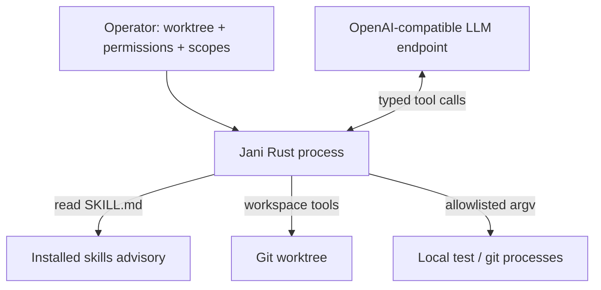

# Architecture and boundaries

## Scope

Jani is a single-process coding agent. It has no embedded coordination engine, task database, identity system or message bus. Its job is to inspect a worktree, edit files within operator-approved scopes, run allowlisted commands, and report what it observed. Any multi-agent coordination is external to this binary.

## Authority

Rust is the only authority inside Jani:

1. **Operator permission:** writes and command execution are default-denied.
2. **Agent tools:** only explicit relative paths inside `--write-path` scopes can be written; only allowlisted argv can run; protected and symlinked paths are refused.
3. **Process boundary:** children receive no shell, no provider API key, and have bounded time and output.

Jani makes no claim of task ownership. It assumes the operator has not pointed multiple agents at the same worktree, or that any external coordinator handles that separately.

## Lifecycle

1. The operator points Jani at a worktree and grants optional write scopes and command execution.
2. Jani discovers available skills, reads relevant ones on demand, and inspects the workspace.
3. The model requests tools; Rust validates each request and either performs it or refuses it.
4. Jani reports tool results and a final answer. Completion is whatever the operator or an external workflow observes; Jani does not assert coordination state it does not own.

The turn loop is bounded by `--max-steps`. Transient provider failures (`408`, `429`, `500`, `502`, `503`, `504`) are retried a limited number of times with a short backoff.

## Skills and collaboration

Skills are Markdown instructions discovered from user and repository directories. They can describe collaboration protocols, review practices or project conventions. Reading a skill does not change Jani's permissions.

If a workflow needs coordination — task claims, epochs, message leases, merge gates — that logic belongs in an external coordinator or a skill-driven process that invokes Jani as a normal CLI. Jani grants it no special authority.

## Rust module layout

- `config.rs`: CLI flags, environment, permissions and path validation.
- `exec.rs`: command allowlist, staged-path verification and direct execution.
- `skills.rs`: skill discovery and Markdown reading.
- `model.rs`: provider API client and JSON tool schemas.
- `agent.rs`: tool loop and prompt composition.
- `workspace.rs`: bounded source inspection and scoped writes.
- `process.rs`: bounded child processes, output handling and truncation.
- `main.rs`: CLI.

## Deliberate architectural decisions

- Jani uses the **OpenAI-compatible Chat Completions tool interface**, not a Python SDK or provider-specific agent framework.
- A `SKILL.md` is advisory. Every permission claim the model is told about must also be enforced in Rust.
- Coordination is deliberately out of scope. Embedding a particular engine would couple the agent's privilege model to one product; external workflows can invoke the same CLI without changing Jani.
- Environment and file-system checks are defense in depth, not an OS-level sandbox.
