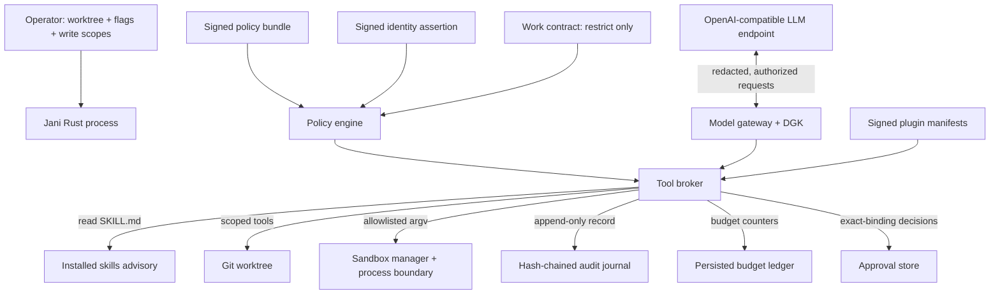

# Architecture and boundaries

## Scope

Jani is a single-process coding agent. It has no embedded coordination engine,
cross-agent task coordinator, distributed message bus or merge authority. The native tools and attention protocol maintain bounded local task metadata. Its job is to inspect a worktree,
edit files within operator-approved scopes, run allowlisted commands, and report
what it observed. Any multi-agent coordination is external to this binary.

Within that single process it implements a trusted local kernel: signed policy,
verified identity, data-governance egress control, a mediating tool broker, a
hash-chained journal, persisted budgets, approvals and OS sandbox selection. The
proposal review in
[`docs/jani_enterprise_proposals/IMPLEMENTATION_REVIEW.md`](jani_enterprise_proposals/IMPLEMENTATION_REVIEW.md)
lists what is still missing; notably there is no IdP, policy administration,
plugin executor or Windows enterprise confinement.

## Authority

Rust is the only authority inside Jani. Authority is layered; each layer can
narrow the ones above it but never widen them.

1. **Operator permission:** writes and command execution are default-denied.
   `--write-path`, `--allow-exec` and related flags are a ceiling.
2. **Signed policy:** enterprise mode requires a signed, tenant-bound
   `OrganizationPolicy`. `defaults.action` must be `deny`; rules are matched by
   action, resource, risk, roles, and effect; explicit denies win. Role-scoped rules
   match only against verified `roles` carried by an `IdentityAssertion`.
3. **Verified identity and contract:** a signed `IdentityAssertion` binds tenant,
   principal, roles, groups, and `approvalScopes` using `--identity-key` trust roots
   strictly isolated from `--policy-key`. A `WorkContract` can restrict capabilities,
   write paths, the sandbox profile, budgets, and structured `acceptanceChecks`;
   omitting a capability or write path grants nothing.
4. **Tool broker:** every model tool call is mapped to a typed `ActionRequest`,
   validated, policy-evaluated, approval-checked, budget-checked and journaled
   before execution. Unknown tools and malformed arguments are journaled denials.
5. **Data gateway:** only the gateway holds the provider credential. It classifies
   decoded message content, redacts secrets, builds data envelopes, authorizes
   egress, then inspects the response. Empty provider/region/purpose allowlists
   deny; `"*"` is the only wildcard.
6. **Sandbox and process boundary:** children receive no shell and no provider API
   key, and have bounded time and output. Isolation-required profiles fail closed
   when no backend can satisfy them; the Windows Job Object reports that it does
   not confine the filesystem or network.
7. **Audit:** the journal is a SHA-256 hash chain. If a record cannot be written,
   the action is denied rather than executed unaudited.

## Lifecycle

1. Parse flags and environment; load policy and identity; validate the optional
   contract; load the plugin registry if configured.
2. Discover skills. Reading a skill is a mediated `skill.read` action and does not
   change permissions.
3. Open the persisted budget ledger for the task.
4. The model requests tools. Rust validates each request and either performs it or
   refuses it, journaling the decision and any sandbox receipt ID.
5. The gateway redacts and authorizes every model request; provider failures
   (`408`, `429`, `500`, `502`, `503`, `504`) are retried a limited number of times.
6. Jani reports tool results and a final answer. Completion is whatever the
   operator or an external workflow observes; Jani does not assert coordination
   state it does not own.

The turn loop is bounded by `--max-steps` (default 100, ceiling 400), by the token and tool-call budgets, and by repeat detection. Those are safety backstops; the loop is built to end in a deliverable, not in a number:

- The model is told, four turns before the end, to stop exploring and finish and verify what it is changing.
- The same call with the same arguments three times in one turn gets a note in its result; the sixth ends the turn.
- When the allowance runs out, or a repeat stops the turn, Jani makes one more model request with tools forbidden (`tool_choice: none`) and asks for a handoff: what is done and verified, what is not, and the next steps. The turn is recorded as **completed** with reason `step_checkpoint` or `repeated_calls`, the conversation is **kept**, and replying "continue" resumes from where it stopped. Nothing is rolled back.
- If even that request fails (budget gone, provider down), the turn fails as before with reason `step_limit` and the usual rollback.

## Skills and collaboration

Skills are Markdown instructions discovered from user and repository directories.
They can describe collaboration protocols, review practices or project
conventions. Reading a skill does not change Jani's permissions.

If a workflow needs coordination — task claims, epochs, message leases, merge
gates — that logic belongs in an external coordinator or a skill-driven process
that invokes Jani as a normal CLI. Jani grants it no special authority.

## Rust workspace layout

Jani follows an ifinpay-style Rust workspace. There is **no root-level `src/` and no `crates/` directory**.

- `contract/`: versioned vocabulary and state machine source of truth.
- `backend/core/` (`jani-core`): signed identity, policy, data-governance, core types, budget, audit, approvals, kill switch and generated contracts; no dependency on the model or CLI.
- `backend/store/` (`jani-store`): SQLite-backed attention state, durable task checkpoints/idempotency (`TaskStore`), plus transaction outbox.
- `backend/verifier/` (`jani-verifier`): model-free contract verifier running structured `acceptanceChecks` and emitting signed `VerificationReceipt`s.
- `backend/server/` (`jani`): executable and composition root; model loop, broker, sandbox, skills, sandboxed sidecar plugins + zero-secret credential proxy, event `dispatch`, alert commands, and CI end-to-end tests.
- `tools/jani-issuer/`: offline Ed25519 keygen and canonical JCS signer for policies, identities, plugins, and assignment grants.
- `tools/jani-check/`: architecture gates and contract checks.

`backend/<package>/src/` exists because Cargo uses `src/lib.rs` and `src/main.rs` **inside each package**. The repository root is a virtual workspace, not a Rust source crate.

The server currently contains more modules than it should long-term. Further extraction should follow demonstrated dependency boundaries, with no speculative empty packages.

See [WORKSPACE_ARCHITECTURE.md](WORKSPACE_ARCHITECTURE.md).

## Deliberate architectural decisions

- Jani uses the **OpenAI-compatible Chat Completions tool interface**, not a Python SDK or provider-specific agent framework.
- A `SKILL.md` is advisory. Every permission claim the model is told about must also be enforced in Rust.
- Coordination is deliberately out of scope. External workflows can invoke the same CLI without changing Jani's privilege model.
- Signed `sidecar` plugins execute out-of-process under `SandboxManager` using
  bounded JSON-RPC over stdin/stdout and a parent-owned `CredentialBroker` proxy
  that injects configured secrets only on declared hosts and scrubs responses; native
  dynamic loading remains refused. MCP operations are mediated by signed contracts,
  delegated authorization and response receipts.
<!-- jani-claim: {"id":"ARCH-MCP-EXECUTOR","kind":"source_contains","path":"backend/server/src/main.rs","needle":"mod mcp;","statement":"MCP operations are mediated by signed contracts, delegated authorization and response receipts."} -->
- Environment and file-system checks are defense in depth, not an OS-level
  sandbox. On Windows and macOS they are not confinement at all for isolation
  purposes; enterprise isolation profiles are refused there rather than claimed.
- Local state uses SQLite/JSON with optional external hash-chain anchoring (`--audit-anchor`).
