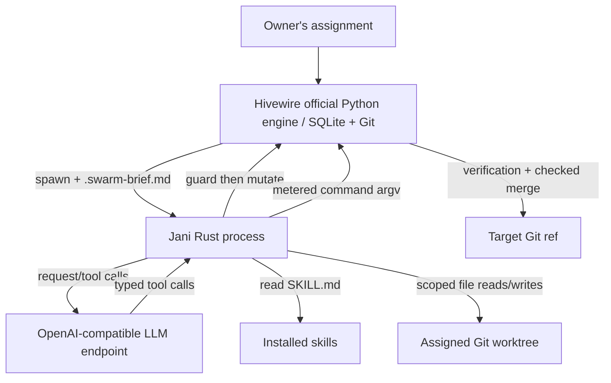

# Architecture and boundaries

## Authority

Hivewire is the only owner of task state, assignment epoch, contracts, review, merging and message receipts. Jani does not read the Hivewire SQLite database. It calls the official Python CLI through the Rust `std::process::Command` API and reads typed protocol-2 JSON.

There are three independent boundaries:

1. **User permission:** Jani default-denies writes, measured execution, merges and bus acks.
2. **Agent tools:** Rust permits only selected Hivewire worker transitions, explicit edit scopes and allowlisted commands.
3. **Engine authority:** Hivewire before-tool gate and engine transitions enforce current task/epoch/contract/interrupt/merge rules. A successful Rust tool alone does not assert integration or task completion.

## Lifecycle

1. Hivewire coordinator approves architecture and assigns a task.
2. Hivewire spawns the registered Jani CLI adapter in its task worktree with `SWARM_AS`, `SWARM_TASK`, `SWARM_EPOCH`, `.swarm-brief.md`, optional `SWARM_BUS_INBOX`.
3. Jani loads the installed `agents-collaboration` skill, queries `environment`, `whoami`, `explain` and `context` as needed.
4. Jani follows plan/questions/start, edits only approved paths, runs metered checks, records step evidence and checkpoints, then commits and submits.
5. Hivewire controls reviewer and serial verified merge. Jani can request `merge` only if the operator granted `--allow-merge`; the engine remains authoritative.
6. Completion depends on stored Hivewire receipts and goal checks, not the model's final response.

## Messaging and interrupts

The supervised relay owns receipt leasing and updates `SWARM_BUS_INBOX`. Jani reads it through its Rust tool, stripping lease tokens before exposing it to the model. `inbox_ack` looks up a current receipt from the trusted local snapshot and delegates acknowledgement to Hivewire. The tool requires operator opt-in and effect evidence. The workflow must still ensure external effects are durably recorded and idempotent; an ack is only delivery handling.

Before all intended external effects, `hivewire bus hook --stage before-tool --enforce --json` is called. If blocked, the Rust boundary refuses the action, even if the model asks to continue. To handle a pause or emergency, Jani should report the control, checkpoint via a permitted recovery path, and wait for authorized resumption. Native hooks cannot preempt arbitrary model requests; checks occur between model calls / tool boundaries.

## Rust module layout

- `config.rs`: CLI flags, environment, explicit permissions and path validation.
- `skills.rs`: skill discovery and Markdown reading.
- `model.rs`: provider API client and JSON tool schemas.
- `agent.rs`: tool loop and invocation policy.
- `hivewire.rs`: typed CLI invocation, fencing, worker commands and acknowledgement.
- `workspace.rs`: bounded source inspection and scoped writes.
- `process.rs`: bounded child processes and output handling.
- `main.rs`: CLI.

## Deliberate architectural decisions

- Jani uses the **OpenAI-compatible Chat Completions tool interface**, not a Python SDK or provider-specific agent framework. Configurable providers can be adopted without changing Hivewire.
- Jani doesn't need Go; its first supported topology is one local Rust worker per Hivewire assignment.
- Rewriting Hivewire's coordination engine in Rust would require a separate compatibility and SQLite schema migration plan. Calling its CLI is the stable option until a compatible replacement is tested.
- Environment and file-system checks are defense in depth, not an OS-level sandbox.
