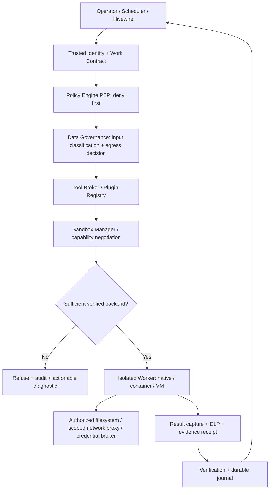
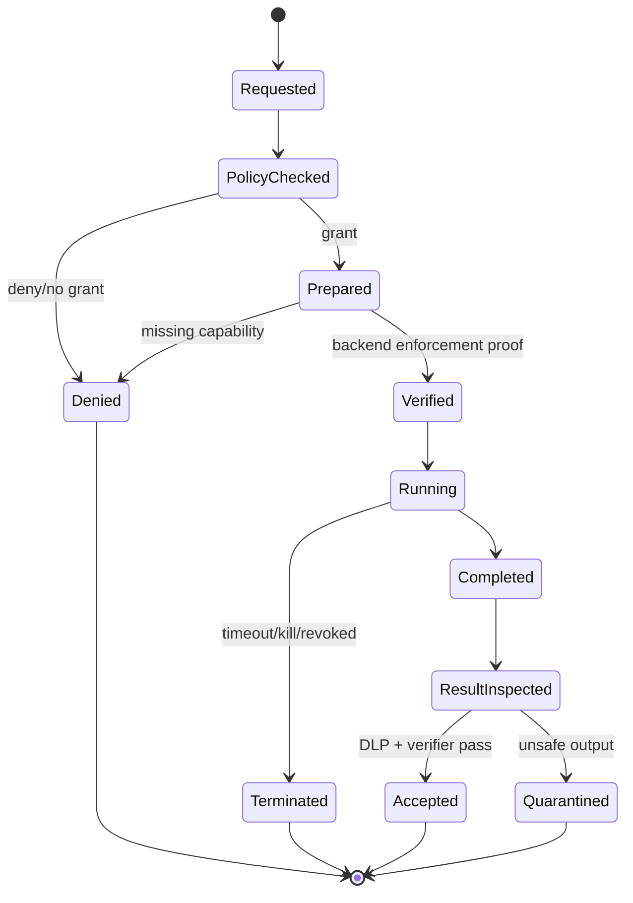

# Jani — First-Class Sandbox and Isolated Execution Architecture

**Proposal ID:** JANI-EP-001  
**Revision:** 2.0 (supersedes the design in `docs/SANDBOX_PROPOSAL.md`; this file does not modify the repository)  
**Status:** Design, **partially implemented** — see [IMPLEMENTATION_REVIEW.md](IMPLEMENTATION_REVIEW.md). bubblewrap (Linux) and Windows Job Object selection exist; Windows cannot satisfy filesystem/network isolation profiles, macOS has no backend, and signed grants/attestation are missing.  
**Baseline:** `ifinsta/jani` `main` at `32feebb2fa79dba23e55a6901c23d45d00f0090b`, reviewed 2026-10-25  
**Companion proposals:** [Data Governance](02_BUILTIN_DATA_GOVERNANCE_PROPOSAL.md), [Organizational Governance](03_ORGANIZATIONAL_POLICY_GOVERNANCE_PROPOSAL.md), [Plugin Architecture](04_PLUGIN_ARCHITECTURE_PROPOSAL.md), [Integrated Rollout](05_INTEGRATED_IMPLEMENTATION_PLAN.md).

## 1. Decision request and executive specification

Approve a **first-class, policy-governed sandbox service embedded in Jani's trusted Rust runtime**, covering *all untrusted execution routes*, including executable tool calls, plugin tools, repository hooks, language runtime scripts, third-party MCP connections, document processing and—where needed—isolated filesystem operations. The sandbox is **not** a discretionary helper loaded as an ordinary plugin. Plugins may provide vetted **backend implementations**, but they may not decide whether sandboxing is required or claim their own enforcement status.

**Security invariant S-001:** every untrusted operation that can execute code or access protected resources passes through a trusted policy enforcement point (PEP) before execution and is confined by a verified isolation backend or refused.  
**Security invariant S-002:** managed/enterprise and untrusted modes are **fail-closed**; no silent downgrade to host execution.  
**Security invariant S-003:** a child receives no ambient enterprise secrets, inherited authentication tokens, unrestricted filesystem visibility or unsanctioned network routes.  
**Security invariant S-004:** all children and descendants are tracked and terminated on cancellation, deadline, budget exhaustion or policy revocation.  
**Security invariant S-005:** repository content, `SKILL.md`, model output and plugin manifests cannot relax a policy established by a trusted administrator.

### 1.1 Differences from the original Jani sandbox proposal

| Original proposal (`docs/SANDBOX_PROPOSAL.md`) | Revised and binding direction | Reason |
|---|---|---|
| Sandbox default `off` in early release | `required` for managed/untrusted profiles; interactive local `trusted-dev` opt-out only via explicit host policy | Prevent accidental unconfined enterprise execution |
| Confine `workspace_command` primarily | All executable and high-risk plugin operations use one execution/authorization broker | Plugins must not become a second escape path |
| Layer 2 may allow read-write worktree when per-path mounts are not supported | Deny execution or switch to a sufficiently confined staging environment; never permit broader write than effective grant | Rust write checks cannot constrain scripts executing directly |
| `HOME` redirection and removed provider keys | Build environment from an allowlist; issue per-action, audience-bound credentials through a broker | Other credentials also leak via environment/files |
| Native host sandbox as standard | Tiered isolation: vetted native backend for lower risk; hardened container/VM/remote worker for hostile code and sensitive data | Protection depends on risk and actual kernel boundary |
| `sandbox-exec` proposed for macOS | No production claim for deprecated mechanisms; use hardened remote Linux worker or a separately security-reviewed native backend | Avoid unsupported security promises |
| Basic `enforced` flag | Attested backend capability, measured restrictions, signed receipts, runtime probes and negative tests | Configuration is not evidence of confinement |
| Process timeout kills one child | Process-tree group/job/cgroup termination with reaping | Prevent surviving grandchildren |
| Startup flags as only authority | Central policy + tenant permissions + contextual action grants; leases and revocation | Enterprise controls must survive CLI flags |

## 2. Actual starting point and scope

Current implementation is a Rust CLI with `Agent::tool()` dispatching `skill_read`, `workspace_list`, `workspace_read`, `workspace_write`, and `workspace_command`. `exec::run()` performs an allowlist validation then calls `process::execute()` using `std::process::Command`. Children inherit most environment variables except for explicitly removed model API keys; the immediate child is terminated on deadline; there is no mandatory OS sandbox. `workspace.rs` has relative-path, sensitive-name and symlink checks, but those are non-atomic and do not confine executable children. A currently documented `docs/SANDBOX_PROPOSAL.md` describes optional bwrap/AppContainer sandboxing. These claims are scoped to the source reviewed; the existing CI was reported failing during the review and must be separately repaired.

### 2.1 Threat model

**Actors:** a malicious Git checkout, poisoned dependency/build script, prompt-injected tool result, forged skill/plugin description, compromised third-party plugin, hostile co-tenant, malicious worker, or accidental operator misconfiguration.

**Protected assets:** tenant-restricted files; other worktrees; host credentials; enterprise connectors and API tokens; user documents; model input/output; event audit history; system availability; customer data; organizational action permissions.

**Attacks to block:** arbitrary code execution outside assigned workspace, credential theft, filesystem reads beyond grants, writes beyond scopes, undeclared network exfiltration, named-pipe/socket access, child process escape, resource exhaustion, git-hook abuse, mount/symlink/path races, token replay, task takeover and policy downgrade.

**Limitations:** no isolation backend is a proof against kernel/hypervisor compromise, side channels or a deliberately malicious host administrator. Security claims must be scoped to a stated threat model and tested backend versions.

## 3. Trusted architecture



A **single trusted invocation path** is mandatory for built-in tools, external tools and plugins. The sandbox backend may execute out of process, but the policy decision, effective grant and receipt are owned by trusted Rust modules. The model may propose operations but never grants permissions.

### 3.1 Sandbox profiles

| Profile | Environment | Minimum guarantees | Allowed escape hatch |
|---|---|---|---|
| `enterprise-restricted` | Managed production, untrusted code, confidential data | Verified isolation; rootless/dedicated identity; no host secrets; deny network; scoped read/write mounts; process group controls; audited actions | None through an agent or tenant setting |
| `enterprise-connected` | Managed enterprise with approved connectors | All above, plus egress only through authenticated allowlisted proxy; narrow per-action credentials | Administrator-approved time-bound exception, never raw host network |
| `development-confined` | Local interactive coding | Verified native isolation, scoped FS, restricted network; warn for weakened posture | Operator may select trusted profile only if host policy allows |
| `trusted-dev` | Explicit, single-user local workstation | Existing Rust tool policy with prominently marked unconfined process risk | Developer-only; **disallowed in enterprise mode** |
| `read-only-model` | Repository analysis without commands | Read paths scoped and DLP checked before model egress; code execution forbidden | None |

A capability matrix is versioned per backend. A profile can run only if a selected backend proves all its required capabilities; no fallback that silently removes filesystem or network controls.

## 4. Platform architecture and selection

**Linux:** preferred local backend is rootless namespace isolation using bubblewrap with explicit mounts and `--unshare-net` where supported; use cgroup v2 and resource rlimits for pids, CPU, memory, I/O; use seccomp as defense in depth. `bwrap` **alone is not** a full quota manager. For hostile/untrusted tasks use a dedicated rootless container (OCI) or ephemeral VM/remote worker, with seccomp, LSM policy and network namespace. **No fallback to weaker Landlock/seccomp alone unless its verified capabilities satisfy the requested profile**, including network control and file-level scope. Probe user namespace availability.

**Windows:** use AppContainer or a hardened isolated worker with a restricted token, per-run ACLs and a Windows Job Object for descendant process lifecycle/limits. Some traditional developer tooling may not operate inside AppContainer: in that case prefer a dedicated isolated Windows worker/VM rather than silently weakening grants. Validate named-pipe, registry, device, UNC path and network permissions under real Windows CI. Job Objects are not a substitute for an AppContainer/security token boundary.

**macOS:** use a managed remote Linux worker for `enterprise-restricted` initially. Local experimental alternatives require independent security review and must not be described as enterprise-grade based on deprecated `sandbox-exec` alone. No automatic unsandboxed fallback.

**Remote workers:** use mutual authentication, device/workload attestation where practical, short-lived signed task grants, per-run containers/VMs, private artifact transfer, host-isolated tenant separation and heartbeat/kill semantics. Reject untrusted worker certificates and stale policy snapshots.

### 4.1 Capability negotiation contract

```rust
// Design sketch; proposed API, not current Jani source.
#[derive(Clone, Debug)]
pub struct RequiredIsolation {
    pub filesystem_roots: Vec<MountGrant>,
    pub allow_network: NetworkPolicy,
    pub forbid_host_secrets: bool,
    pub restrict_process_tree: bool,
    pub resource_limits: ResourceLimits,
    pub tenant_isolation: TenantIsolation,
}

pub trait SandboxBackend: Send + Sync {
    fn id(&self) -> &'static str;
    fn probe(&self) -> Result<VerifiedCapabilities, SandboxError>;
    fn prepare(&self, grant: &SignedExecutionGrant) -> Result<PreparedSandbox, SandboxError>;
    fn spawn(&self, prepared: PreparedSandbox, action: &ValidatedAction)
        -> Result<ChildHandle, SandboxError>;
    fn terminate_tree(&self, child: &ChildHandle) -> Result<(), SandboxError>;
    fn attest(&self, child: &ChildHandle) -> Result<EnforcementEvidence, SandboxError>;
}
```

`probe` must measure actual system capabilities; `attest` records which restrictions were applied and a backend implementation/version. A backend plugin **cannot** self-certify as trusted; production backends are allowlisted by administrators after conformance tests and signature validation. The executor checks its evidence before releasing any sensitive input or credential.

## 5. Filesystem and process confinement

1. Stage an immutable read-only source snapshot or private worktree. Refuse symlinks to host paths, hardlink surprises, mount tricks and unexpected device nodes; use handle-relative/no-follow APIs where supported for trusted writes. Protect against races with confinement **independent** of path validation.
2. Make repository root read-only except explicit writable files/directories; create a separate writable output and scratch directory. No whole-worktree read-write fallback for restricted profiles. `.git` is read-only by default; perform Git staging/commit via a distinct trusted Git integration stage after reviewing a proposed patch.
3. Pin image/toolchain by digest; mount compiler/tool caches read-only; use narrowly scoped ephemeral cache writes when required.
4. Provide a newly created `HOME`, temp root and minimal environment. Use `env_clear()` and reconstruct required keys, not a blocklist. No SSH agent, Docker socket, cloud metadata endpoint, host credential mounts, shell history, inherited token or home directory.
5. Use child process groups on Unix and Job Objects on Windows, cgroup/limits where available; kill and reap descendants on timeout, cancellation, denial or supervisor death; garbage-collect orphan sandboxes.
6. Bound stdout/stderr, CPU, memory, pids, wall time, file size, disk I/O and network volume. Truncate display output, but preserve a limited redacted forensic digest/receipt. Limit pre-enforcement buffering and streaming memory.
7. Block special files, UNIX sockets, named pipes, sensitive `/proc` exposure, link-based paths and setuid/capability elevation; disable privileged containers.
8. For a requested write, produce an immutable candidate patch/overlay and pass it to a **trusted patch-apply stage** that enforces write grants, hash preconditions and workspace generation/epoch.
9. Separate risk: *reading source to send to an LLM* is a data-egress decision, not merely an FS sandbox question; the data-governance proposal applies before model invocation.

### 5.1 Network policy

Default is `deny`. For `enterprise-connected`, route outbound traffic through a purpose-built authenticated egress proxy. Allow destination **service identities**, approved hostnames and TLS policy, not an arbitrary CIDR range chosen by the model. Recheck redirect chains, DNS rebinding and addresses after resolution; reject loopback, link-local, RFC1918 and cloud metadata targets unless a specifically approved internal service is requested. Control WebSocket and HTTP CONNECT. Limit bytes and calls. Model calls originate from the trusted model gateway with DLP preflight, never directly from arbitrary sandboxed tools.

### 5.2 Secret handling

Use one trusted `CredentialBroker`. Plugins request a capability (example: `github:issues.write`) and receive only a short-lived scoped credential **inside an isolated tool invocation**, ideally through a brokered API rather than raw secrets. Never disclose broker master keys to plugins or model context. Redact outputs and deny environment inheritance. Every issuance references actor, tenant, resource, task, audience, approval and expiration, with revocation support.

## 6. End-to-end action lifecycle and state machine



**Critical ordering:** `authenticate → load signed tenant policy → classify inputs → authorize capabilities → select backend → prepare isolation → verify restrictions → release scoped inputs → execute → capture/redact output → verify requested result → store receipt → clean up`.

**Revocation:** an active grant uses a short lease. On policy revocation, the supervisor cancels the invocation; non-terminable external actions are marked `uncertain` and reconciled by a connector-specific status check, not replayed blindly.

**Crash recovery:** a persistent invocation journal tracks `requested`, `policy_granted`, `prepared`, `started`, `stopped`, and `accepted`. Recovery scans leases, terminates orphaned workers, quarantines unverified outputs and checks side effects before retry.

## 7. Contracts and configuration

### 7.1 Example trusted organization policy (proposed)

```yaml
apiVersion: jani.dev/v1alpha1
kind: SandboxPolicy
metadata:
  name: managed-default
spec:
  enforcement: required
  allowedProfiles: [enterprise-restricted, enterprise-connected]
  defaultProfile: enterprise-restricted
  filesystem:
    workspace: read-only
    writes: explicit-scopes-only
    gitMetadata: read-only
    hostHome: deny
  network:
    default: deny
  process:
    timeoutSeconds: 300
    memoryMiB: 1024
    maxProcesses: 32
    cpuMillis: 2000
  backends:
    prefer: [linux-oci, linux-bwrap, windows-isolated-worker]
    onUnsupported: deny
  audit: required
```

This manifest must come from a **trusted administrative configuration source** and be cryptographically bound to tenant, revision and grant. A repository file can request *stricter* limits, never weaker ones.

### 7.2 Invocation (JSON example)

```json
{
  "schema_version": "1.0",
  "task_id": "task-203",
  "invocation_id": "inv-44",
  "tenant_id": "tenant-demo",
  "principal_id": "worker-7",
  "action": {"tool": "rust.cargo_test", "argv": ["cargo", "test", "--locked"]},
  "requested_profile": "enterprise-restricted",
  "workspace_digest": "sha256:<digest>",
  "requested_scopes": ["src/payments", "tests/payments"],
  "policy_revision": "orgpol-18",
  "deadline_utc": "2026-10-25T10:00:00Z"
}
```

Hashes, IDs and times in examples are illustrative. The true request includes a signed grant digest, an idempotency key, an expiration/nonce, immutable image digest, budgets and approval references, if required. The runtime rejects unknown mandatory fields and prevents unsigned callers from injecting identity/policy attributes.

### 7.3 Receipt contract (JSON example)

```json
{
  "invocation_id": "inv-44",
  "state": "accepted",
  "profile": "enterprise-restricted",
  "backend": {"id": "linux-oci", "version": "verified-build", "attested": true},
  "effective_policy_digest": "sha256:<policy-hash>",
  "input_digest": "sha256:<input-hash>",
  "output_digest": "sha256:<output-hash>",
  "exit_code": 0,
  "termination_reason": null,
  "network_egress_bytes": 0,
  "cpu_ms": 1200,
  "evidence_ids": ["evt-887"]
}
```

Include sandbox profile, capabilities applied, resource metering, denial reasons, before/after tree hashes, verifier results and retention labels. A receipt is not automatically evidence that business requirements were satisfied.

## 8. Suggested Rust modules and migration

```text
src/
  security/identity.rs
  security/capabilities.rs
  policy/pep.rs
  data/classification.rs
  runtime/invocation.rs
  runtime/supervisor.rs
  runtime/journal.rs
  sandbox/mod.rs
  sandbox/profile.rs
  sandbox/backend.rs
  sandbox/linux_bwrap.rs
  sandbox/linux_oci.rs
  sandbox/windows_isolation.rs
  sandbox/remote.rs
  sandbox/attestation.rs
  sandbox/egress.rs
  secrets/broker.rs
  tools/broker.rs
  tools/builtin.rs
  workspace/overlay.rs
  workspace/patch_apply.rs
  telemetry/events.rs
```

Refactor `agent::tool` to call `ToolBroker::invoke`, not directly `exec::run` or `workspace.write`. Replace `process::execute` with `SandboxManager::invoke` in managed modes. Retain `jani run`, `jani doctor`, `--print`, `--allow-write`, and `--write-path` as local UX compatibility where safe; enterprise policy can only **restrict** their effect. Phase in `jani sandbox doctor`, `jani sandbox check`, and `jani inspect <invocation-id>` with structured JSON output. Mark direct unsandboxed invocation as unsupported in enterprise.

### 8.1 Change control

- Introduce feature flag `jani_sandbox_v2` in development; all managed-profile CI trials must enforce it before release.
- Keep a legacy execution adapter for **trusted local** workflows only, never enabled automatically for a tenant.
- Do not reassign a tool call to an unapproved execution backend on failure; refuse or request administrator intervention.
- Version all policy schemas; log deprecations; block unrecognized higher schema major versions.

## 9. Test matrix and minimum acceptance catalogue

| Test | Attack / failure | Expected result |
|---|---|---|
| SBX-001 | Tool tries to read `~/.ssh` | Denied by FS restriction |
| SBX-002 | Cargo `build.rs` reads parent checkout | Denied |
| SBX-003 | npm `postinstall` calls network | Egress blocked by OS/network boundary |
| SBX-004 | File symlink swapped after validation | Escape blocked by independent mount/handle boundary |
| SBX-005 | Process spawns grandchildren and hangs | Entire process tree terminated/reaped |
| SBX-006 | Child reads unrelated cloud credentials from environment | No inherited credentials |
| SBX-007 | Git hook invokes executable | Confined or handled at trusted Git stage |
| SBX-008 | Backend unavailable | Fail closed before sensitive input release |
| SBX-009 | Backend falsely claims network deny | Attestation/conformance failure blocks it |
| SBX-010 | Worker killed mid-write | No unauthorized partial application |
| SBX-011 | Egress proxy follows redirect to metadata IP | Blocked |
| SBX-012 | Tenant A references Tenant B directory | Denied, incident evidence generated |
| SBX-013 | Disk fill, process fork bomb, output flood | Bounded termination and cleanup |
| SBX-014 | Provider/model instructs `--sandbox off` | No authority to change policy |
| SBX-015 | User-approved task expires during execution | Revoked/terminated and journaled |
| SBX-016 | Windows named pipe/UNC escape attempt | Denied |
| SBX-017 | Malicious native plugin tries to spawn process itself | Impossible from hosted WASM; external sidecar confined; no in-process untrusted native |
| SBX-018 | Host reboot before cleanup | Recovery reaps orphaned workers; quarantines outputs |
| SBX-019 | Checkout includes `.gitconfig`/alternate hooks | Git stage ignores untrusted external execution paths |
| SBX-020 | `HOME`, `PATH`, or package registry variables maliciously set | Controlled env and pinned toolchain refuse abuse |

**Release gates:** green Ubuntu + Windows CI; live provider workflow passes; native and remote restricted sandbox trials pass on their supported targets; zero successful boundary escapes in published adversarial suite; process-tree test passes; denial auditing proven; no security claim for macOS local backend until validated; third-party red-team review prior to production sensitive data.

## 10. Delivery slices with done criteria

1. **SBX-M0 (baseline):** repair CI; add model mock, typed tool envelopes, durable event IDs, `jani sandbox doctor`; tool inventory completed. *Done:* current behavior tested reproducibly on target OSes.
2. **SBX-M1 (mandatory broker):** refactor all built-ins through policy-checked `ToolBroker`, introduce signed execution grant and capability matrix. *Done:* mock plugin cannot call a privileged bypass path.
3. **SBX-M2 (Linux isolation):** implement bwrap/OCI profile, mounts, network deny, quotas and runtime attestation. *Done:* hostile test repository passes SBX-001–015.
4. **SBX-M3 (process lifecycle):** supervisor, complete process-tree teardown, persistent journal, cancellation, orphan cleanup. *Done:* crash and reboot injection reconciles without unmanaged descendants.
5. **SBX-M4 (Windows):** AppContainer/Job Object or dedicated hardened worker. *Done:* Windows suite proves equivalent *effective* protection for supported profile.
6. **SBX-M5 (connected workflows):** approved proxy and credential broker; external connector action receipts, manual approvals. *Done:* no direct host network/secret access.
7. **SBX-M6 (hardening):** third-party review, fuzz property/property-based tests, supply-chain attestations, documented support matrix. *Done:* managed mode meets published SLA/security gates.

## 11. Open design decisions and recommended defaults

- **Default mode:** `required` for enterprise; `development-confined` locally after backend ready; `trusted-dev` only explicit administrator-permitted downgrade. **Decision:** adopt.
- **Writable worktree:** never broad RW fallback in managed; stage overlay and controlled apply. **Decision:** adopt.
- **macOS:** remote isolated worker until validated local isolation; no deprecated-only production dependency. **Decision:** adopt.
- **Containers vs native:** choose by verified capability and risk rather than ideology; reserve stronger VM isolation for highest-risk workloads. **Decision:** adopt.
- **Policy source:** trusted organization and authenticated operator, not repository. **Decision:** adopt.
- **Backend plugins:** signed, allowlisted adapters with conformance tests; security authority remains in core. **Decision:** adopt.

## 12. References

- Current source: https://github.com/ifinsta/jani/tree/32feebb2fa79dba23e55a6901c23d45d00f0090b
- Prior proposal: https://github.com/ifinsta/jani/blob/main/docs/SANDBOX_PROPOSAL.md
- bubblewrap manual: https://manpages.debian.org/unstable/bubblewrap/bwrap.1.en.html
- Microsoft AppContainer isolation: https://learn.microsoft.com/en-us/windows/win32/secauthz/appcontainer-isolation
- Microsoft Windows application isolation: https://learn.microsoft.com/en-us/windows/security/book/application-security-application-isolation
- OWASP Agent/MCP security guidance: https://owasp.github.io/DevSecOpsGuideline/2-Process/2-2-Develop/2-2-5-AI-Agent-and-MCP-Security/

**No proposal here establishes compliance certification or safety without implementation, tests and independent review.**
