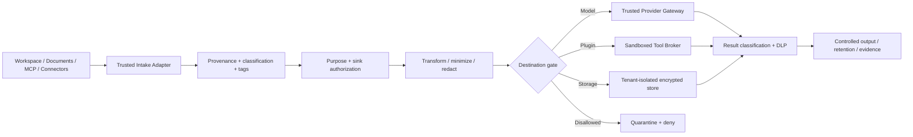

# Jani — Built-In Data Governance, Privacy and Information Control

**Proposal ID:** JANI-EP-002  
**Revision:** 1.0 · **Status:** Partially implemented — see [IMPLEMENTATION_REVIEW.md](IMPLEMENTATION_REVIEW.md). Classification, redaction and fail-closed model egress exist; encrypted storage, retention/erasure, lineage and region attestation do not.  
**Baseline:** `ifinsta/jani` `main` at `32feebb2fa79dba23e55a6901c23d45d00f0090b`, reviewed 2026-10-25  
**Related:** [Sandbox](01_FIRST_CLASS_SANDBOX_PROPOSAL.md) · [Organization Policy](03_ORGANIZATIONAL_POLICY_GOVERNANCE_PROPOSAL.md) · [Plugins](04_PLUGIN_ARCHITECTURE_PROPOSAL.md) · [Implementation Plan](05_INTEGRATED_IMPLEMENTATION_PLAN.md)

## 1. Problem, decision and non-negotiable principles

Jani currently reads repository content, includes tool output in prompts, sends conversation content to an OpenAI-compatible provider, and returns results. File-path filtering is **not data governance**: sensitive content may exist in an otherwise ordinary source file, test fixture, README, issue or connector response. In an enterprise, every transfer into model context, plugin tools, memory, output artifacts, external APIs, telemetry or training/evaluation must be governed by purpose and permissions.

**Decision:** implement a **built-in Data Governance Kernel (DGK)** in the trusted Rust path that classifies, labels, authorizes, transforms, tracks and disposes of all data. Plugins may register classifiers, transformations, storage drivers and domain-specific policies but **cannot disable** the kernel or override a tenant's maximum permitted exposure.

**Invariants:**

- **DG-001:** all data-bearing objects have an owner/tenant, sensitivity, purpose, provenance, retention policy and locality labels *before* sensitive use or egress.
- **DG-002:** no model request, external connector action or plugin invocation sends data outside the allowed sink, provider region, purpose or sensitivity boundary. Deny on missing effective label or policy.
- **DG-003:** labels are monotonic toward greater sensitivity unless an authorized declassification workflow has evidence and approval; derived content inherits the most restrictive relevant labels.
- **DG-004:** private and regulated data is never persisted in debug logs, error strings or unconstrained plugin telemetry.
- **DG-005:** deletion and retention decisions are enforced by storage lifecycle, not by instructions to the language model.
- **DG-006:** Jani never claims to have withdrawn data already sent to an external provider; third-party processing and deletion are governed by contract and available APIs.
- **DG-007:** skills, documents and third-party tool output are untrusted *content*; they are never policy/authority sources.

## 2. Goals, boundaries and legal posture

**Goals:** data discovery; purpose limitation; collection minimization; source/sink policy; tenant isolation; model-provider routing restrictions; residency and retention; personal-data workflows; redaction/tokenization; cryptographic protection; provenance/lineage; evidence; cross-border transfer recording; connector safeguards; administrative review.

**Non-goals for first release:** universal legal advice, automatic compliance certification, perfect DLP sensitivity detection, retroactive deletion from every third-party model, hard real-time streaming of arbitrary large files, or indexing an organization's entire data estate by default. Compliance mappings (GDPR, Kenya Data Protection Act, ISO 27001, SOC 2, HIPAA when applicable) are selectable control maps—not a declaration that implementation alone satisfies those regimes.

## 3. Information classes, labels and policy defaults

| Label | Examples | Default AI/provider handling | Local actions and retention |
|---|---|---|---|
| `PUBLIC` | open-source README, public documentation | Authorized model providers/regions | Standard ephemeral retention |
| `INTERNAL` | internal code, tickets, customer-independent operations | Approved enterprise provider with contractual terms | Tenant isolated; limited logs |
| `CONFIDENTIAL` | proprietary code, financial statements, customer invoices | Approved provider only after purpose/region/DLP gate | Encrypted data plane; strict retention |
| `RESTRICTED` | sensitive personal data, unreleased credentials metadata, protected payment details | Default deny external model; explicit approved route for narrowly minimized subsets | Strong approval, tenant isolation and short retention |
| `SECRET` | API keys, passwords, signing keys, authentication sessions | **Never** send to model or generic plugin; use secret broker handle | Not stored in prompts/memory/trace; rotate on exposure |

Labels are ordinal only as a simplification. Additional **orthogonal tags** include `PII`, `CHILD_DATA`, `PCI`, `PHI`, `TRADE_SECRET`, `CUSTOMER_PROVIDED`, `EXPORT_CONTROLLED`, `SOURCE_LICENSE`, `LEGAL_HOLD`, `RESIDENCY:KE`, `RESIDENCY:EU`, `RETENTION:30D`, `PURPOSE:SUPPORT`, `PURPOSE:SOFTWARE_DEV`, and `CONSENT_REF`. Policy decisions evaluate both sensitivity and tags; a `PUBLIC` document still may have license restrictions and a `CONFIDENTIAL` document may lack personal data.

### 3.1 Label and trust precedence

1. Trusted administrator-enforced tenant rules form the floor of protection.
2. Source system metadata and verified contracts add restrictions.
3. An owner may elevate classification, but cannot weaken tenant restrictions.
4. Automatic classifiers may raise classification; lowered classification requires audited approval with evidence.
5. If classifiers disagree, use the **most restrictive** outcome pending review.
6. If an external plugin omits or falsifies a label, quarantine until independently classified; never treat the plugin's self-reported `PUBLIC` as sufficient.
7. Data mixed from multiple sources inherits the join of relevant restrictions, including allowed purposes, regions and retention (usually the shortest applicable ordinary retention; legal holds and statutory requirements take precedence).

## 4. Trusted data flow and decision points



**Mandatory enforcement points:** (1) ingest, (2) model prompt construction, (3) model output handling, (4) tool input, (5) tool output, (6) artifact publish/export, (7) memory retrieval/write, (8) telemetry and audit, (9) backups and deletion, (10) any cross-tenant transfer. Streaming output must be gated in bounded chunks or buffered for inspection according to the required risk tier; do not leak sensitive output before a full security decision when full scanning is required.

### 4.1 Source → content → sink semantics

A destination is a **specific** sink, not the word “AI.” Sink identity includes provider, model family, approved endpoint, processing region, retention/training commitments, contractual reference and organization; for tools, exact connector/service/resource and permissions. Re-evaluate if the provider, region, destination or declared purpose changes during retries or fallbacks.

Example: confidential code may be allowed for provider `enterprise-llm-east` under `SOFTWARE_DEV`, but **not** allowed in a public-model fallback or in a third-party issue-tracker integration, even if both use HTTPS.

### 4.2 Default-deny egress matrix (illustrative)

| Data class | Approved enterprise model | Public model endpoint | External plugin/tool | Local isolated analysis |
|---|---|---|---|---|
| PUBLIC | Allow by purpose | Allow if tenant permits | Allow scoped | Allow |
| INTERNAL | Permit if model/provider approved | Deny by default | Permit only reviewed connector | Allow |
| CONFIDENTIAL | Permit with contract/region/minimization | Deny | Deny unless explicit narrow permission | Allow with restricted sandbox |
| RESTRICTED | Deny unless explicit authorized exception | Deny | Deny unless exceptional permitted scoped use | Allow within restricted boundary, if purpose valid |
| SECRET | Deny | Deny | Broker-only operation, never raw value | Broker-only operation, never raw value |

**A provider API request is data export.** The DGK therefore runs **before `model.complete()`**, not only before filesystem writes.

## 5. Proposed data contracts and object model

```rust
// Illustrative interfaces only; not current repository code.
pub struct DataEnvelope {
    pub id: DataId,
    pub tenant: TenantId,
    pub source: Provenance,
    pub classification: Classification,
    pub tags: Vec<DataTag>,
    pub allowed_purposes: Vec<Purpose>,
    pub retention: RetentionRule,
    pub data_residency: ResidencyConstraint,
    pub content_digest: Digest,
    pub encrypted_blob_ref: BlobRef,
}

pub struct DataDecisionRequest {
    pub principal: Principal,
    pub task_id: TaskId,
    pub source_ids: Vec<DataId>,
    pub purpose: Purpose,
    pub sink: SinkIdentity,
    pub transformation: TransformPlan,
    pub policy_revision: PolicyRevision,
}

pub enum DataDisposition { Allow, AllowTransformed(TransformPlan), RequireApproval, Quarantine, Deny }

pub trait GovernanceGate: Send + Sync {
    fn classify(&self, input: &IngestedObject) -> Result<ClassifiedEnvelope, GovernanceError>;
    fn authorize_transfer(&self, request: &DataDecisionRequest) -> Result<DataDisposition, GovernanceError>;
    fn inspect_output(&self, output: &OutputEnvelope) -> Result<OutputDisposition, GovernanceError>;
}
```

All data references are immutable, tenant-scoped and carry classification revision. `DataId` is not authorization. The caller must prove capability and purpose on each read. `Digest` proves integrity, **not confidentiality**. Storage encryption is required independently.

### 5.1 Envelope JSON example

```json
{
  "schema_version": "1.0",
  "data_id": "data-91",
  "tenant_id": "tenant-demo",
  "owner_principal": "team-payments",
  "source": {"type": "git", "resource": "src/payments/callback.rs", "revision": "commit-id"},
  "classification": "CONFIDENTIAL",
  "tags": ["TRADE_SECRET", "PURPOSE:SOFTWARE_DEV"],
  "allowed_purposes": ["SOFTWARE_DEV"],
  "allowed_regions": ["KE"],
  "retention": {"rule": "delete_after_days", "days": 14},
  "content_digest": "sha256:<digest>",
  "blob_ref": "tenant://encrypted/data-91"
}
```

`blob_ref` is an internal reference that cannot be dereferenced by an agent or remote plugin directly. Producer-reported labels are verified via trusted adapters/classifiers. Actual residency constraints need a policy-backed mapping of physical storage/processing location rather than mere string comparison.

## 6. Classification, detection and transformations

**Layered classification pipeline:**

1. **Deterministic rules:** key names, file types, structured metadata, provenance, domain schema, source ACL, repositories, contractual tags, known credential patterns; immediate secret detection.
2. **Structured detectors:** appropriate validation for IDs, payment-like data, contact details, business identifiers, regulated datasets and jurisdiction-specific sensitive attributes; avoid retaining detector matches in logs.
3. **Optional ML classifier plugin:** can recommend upward restrictions or review, never clear `RESTRICTED` or `SECRET` on its own.
4. **Human reclassification:** dual approval for high-risk declassification; explicit affected objects, purposes, rationale, expiration and audit evidence.

**Transforms:** exact field projection; remove columns/rows; tokenization with tenant-keyed mapping; pseudonymization (not represented as anonymization); redaction; aggregation with minimum cohort and suppression thresholds; secret stripping; deterministic test-data replacement; attachment filtering. Every transform includes signed lineage from source to derived object plus a residual-risk label.

**Important:** pattern detectors cannot guarantee detecting every secret or personal field. Sensitive sources should receive protective classification from provenance before scanning; negative detector results do not justify automatic downgrade.

## 7. Model governance and prompt boundaries

The `ModelGateway` accepts only `DataEnvelope` references and a task purpose; it resolves content through the DGK, applies transformations and provider routing, records request metadata (not unredacted prompt by default), invokes approved provider and reclassifies response. Define policy for:

- Approved providers/models, endpoint TLS requirements, contractual commitments, allowed regions and forbidden data classes.
- No automatic cross-provider failover when confidentiality, retention or residence constraints change.
- Prompt injection: data from `SKILL.md`, web, issue tracker or tool output remains data; instruction hierarchy is enforced in the orchestrator and tool policy, not solely by a system prompt.
- Context windows: avoid dumping entire repository when selective source slices are sufficient; use a tenant-scoped retrieval index with TTL.
- Retrieval: authorization checks at **query time and dereference time**; embedding metadata and vector search are governed too.
- Evaluation and feedback: require independent purpose grant to reuse real customer content; default to synthetic evaluation datasets.
- Model response: treat generated PII or secrets as protected derived data, not as automatically public because it came from a model.

## 8. Storage, encryption, residency and lifecycle

**Storage layers:** (a) hot execution scratch, (b) durable encrypted artifacts, (c) minimal event journal/metadata, (d) optional searchable index, (e) backups. All keyed by tenant, purpose and object ID. Separate encryption domains for distinct tenants and environments; prefer envelope encryption through an organizational KMS/HSM integration. Keys rotate and recovery is tested. Keep object ownership and deletion indexes independent of embeddings/full-text storage.

**Default retention design:** scratch is purged after verified run cleanup; unapproved raw prompt payloads are not persisted; output artifacts follow tenant policy; minimal security receipts may remain longer; security logs contain only sanitized metadata and hashes; backups have a published expiry and restore-deletion process. Retention durations are policy values, not universal fixed numbers; legal holds supersede ordinary purge but require explicit scope and review.

**Deletion sequence:** authenticate requester → verify right and scope → identify all derived objects via lineage → mark pending purge → revoke reads/exports → delete hot objects/indexes/caches → schedule backup expiry/cryptographic erasure where applicable → request third-party erasure via supported contractual process → record evidence and *exceptions*, e.g. lawful hold, not a false claim of full deletion. Provide DSAR/data subject access and correction workflows where legally appropriate.

**Residency:** validate provider processing locations, cloud-region storage, queues, telemetry export, backups, failover and administrators/support access. Reject fallback to disallowed region. Residency is a deployment and legal constraint, not an automatic assurance provided by a tag.

## 9. Multi-tenant authorization and side-channel controls

Tenant boundary is enforced in the data store, encryption, credential broker, task journal and every plugin invocation. Every query takes tenant identity from an authenticated session, **never** a model-provided tenant string. Add row-level authorization or per-tenant store partitions; cache keys include tenant + policy revision + purpose + sensitivity. Tenant metadata cannot leak through enumeration, cross-tenant error messages, similarity search or debug metrics.

Separate processing zones by highest data risk. Do not share writable volumes between tenants or reuse a dirty sandbox for another tenant. Rate-limit expensive classification scans and retrieval operations; never disclose classifier matches in denied-action error bodies.

## 10. External plugin and connector controls

A connector contributes source metadata, terms and capabilities, but source claims are untrusted unless attested or validated. The DGK wraps every plugin boundary:

`source plugin → trusted ingest gateway → classify → store envelope → authorize requested transfer → minimize → sandboxed plugin execution → output scan → lineage/audit`.

Plugin grants include data categories and specific endpoints. A plugin requesting `contacts.read` cannot expose `contacts.export_all` merely because that tool appears in a dynamic tool list. Changing a plugin version or its schema invalidates stale sensitive-data approvals until reviewed.

**Plugin data contract:**

```yaml
capabilities:
  - name: crm.contacts.lookup
    sensitivity_supported: [PUBLIC, INTERNAL, CONFIDENTIAL]
    purposes: [CUSTOMER_SUPPORT]
    outbound_data: [contact_id, request_id]
    inbound_data: [name, status]
    residency: [KE]
    retention: ephemeral
```

This manifest is a **request** for capabilities. Actual authorization comes from signed organization policy. Dynamic MCP tool descriptions never confer permission.

## 11. Policy examples

```yaml
apiVersion: jani.dev/v1alpha1
kind: DataGovernancePolicy
metadata: {name: engineering-data}
spec:
  classify:
    sourceDefaults:
      "repo:private": CONFIDENTIAL
      "repo:public": PUBLIC
    secretDetection: enabled
  modelEgress:
    default: deny
    allow:
      - sourceClasses: [PUBLIC, INTERNAL]
        purpose: SOFTWARE_DEV
        providerClass: approved-enterprise
        regions: [KE]
        transforms: [minimize, redact-secrets]
  pluginEgress:
    default: deny
  storage:
    encryption: required
    tenantIsolation: required
    scratchRetention: run-only
  audit:
    rawPayloads: forbidden
```

The example is illustrative. Exact region/provider capabilities must be verified by procurement, infrastructure and legal review. Policy is versioned/signed via the organization governance plane and must not be trusted merely because this YAML exists on disk.

## 12. Proposed service interfaces and events

| Interface / operation | Input | Output | Invariant |
|---|---|---|---|
| `classify` | source ref, verified metadata, actor | `DataEnvelope` | Unknown/high-risk untrusted data quarantined |
| `check_transfer` | envelope IDs, purpose, sink, principal | allow/transform/deny/approval | No transfer without decision ID |
| `transform` | approved plan, envelope IDs | derived envelopes, lineage | Never silently weaken classification |
| `model_invoke` | task + approved envelopes | classified response | No direct provider call bypass |
| `plugin_invoke` | capability + envelopes | classified result | Scoped data + sandbox |
| `publish_artifact` | classified output + destination | receipt | Destination checked at publish time |
| `delete_request` | subject/object scope | status, exception report | Cascades along lineage |
| `audit_export` | approved filter | sanitized evidence | Separation of duties and logging rules |

Emit typed events including `data.ingested`, `data.classified`, `data.transformed`, `data.transfer_denied`, `data.egress_approved`, `data.retention_due`, `data.deleted`, `data.delete_exception` and `data.policy_violated`; include `tenant_id`, task/invocation ID, object digest, policy revision and decision ID, **never raw sensitive contents**.

### 12.1 Minimum relational metadata schema

```sql
CREATE TABLE data_objects (
  tenant_id TEXT NOT NULL,
  data_id TEXT NOT NULL,
  owner_id TEXT NOT NULL,
  class TEXT NOT NULL,
  tags_json TEXT NOT NULL,
  source_json TEXT NOT NULL,
  object_digest TEXT NOT NULL,
  encrypted_blob_ref TEXT NOT NULL,
  retention_rule_json TEXT NOT NULL,
  policy_revision TEXT NOT NULL,
  created_at TEXT NOT NULL,
  PRIMARY KEY (tenant_id, data_id)
);
CREATE TABLE data_lineage (
  tenant_id TEXT NOT NULL,
  parent_id TEXT NOT NULL,
  child_id TEXT NOT NULL,
  transformation_id TEXT NOT NULL,
  PRIMARY KEY (tenant_id, parent_id, child_id)
);
CREATE TABLE data_transfers (
  tenant_id TEXT NOT NULL,
  transfer_id TEXT NOT NULL,
  task_id TEXT NOT NULL,
  principal_id TEXT NOT NULL,
  purpose TEXT NOT NULL,
  sink_id TEXT NOT NULL,
  decision_id TEXT NOT NULL,
  object_ids_json TEXT NOT NULL,
  state TEXT NOT NULL,
  created_at TEXT NOT NULL,
  PRIMARY KEY (tenant_id, transfer_id)
);
```

Also require `tenant_id` in child FKs to avoid cross-tenant lineage references, indexed retention/deletion queue, immutable event log with integrity chaining, and per-store transactional isolation. For production choose schema migrations, row-level security where available, HA/backup and concurrency limits after evaluating target storage.

## 13. Implementation layout

```text
src/data_governance/
  mod.rs
  envelope.rs
  classification.rs
  provenance.rs
  sink_registry.rs
  transfer_gate.rs
  transform.rs
  dlp.rs
  residency.rs
  retention.rs
  erasure.rs
  lineage.rs
  audit.rs
src/provider/gateway.rs
src/secure_store/{tenant,blob,index,keys}.rs
src/telemetry/redaction.rs
plugins/governance/                    # optional detectors, storage drivers
```

Refactor `workspace_read` and `skill_read` to produce classified `DataEnvelope` objects, not immediately feed raw content into the model. Refactor `model.rs` to accept only approved context bundles through `ModelGateway`; refactor `agent.rs` so tool result payloads are classified before subsequent model turns. Persist durable records through a minimal SQLite implementation for local development, with an enterprise storage adapter later. The implementation must support `read-only` tasks without unnecessarily copying data into permanent storage.

## 14. Test matrix and release gates

| Test | Input / failure | Expected decision |
|---|---|---|
| DG-001 | Private code source lacking labels | Classified at least `CONFIDENTIAL` by source policy |
| DG-002 | Secret embedded in ordinary README | Secret never forwarded to provider |
| DG-003 | Classifier returns false negative on PII | Source-derived restriction remains effective |
| DG-004 | Plugin reports restricted material as public | Plugin classification not trusted; quarantine or upgrade |
| DG-005 | Model fallback changes provider region | Denied unless reauthorized with correct region |
| DG-006 | Long chunked output includes secret in final chunk | No premature export under full-buffer policy |
| DG-007 | Attempt cross-tenant retrieval by data ID | Denied without existence leak |
| DG-008 | Declassification without required second approval | Denied, incident recorded |
| DG-009 | Unindexed derived embedding survives deletion | Test detects and blocks release |
| DG-010 | Data subject erasure with legal hold | Exceptions explicit; no blanket deletion claim |
| DG-011 | Backup restore after purge request | Tombstone/erasure policy reapplied |
| DG-012 | API retry copies confidential content to alternate provider | Denied |
| DG-013 | Plugin telemetry emits raw record | Redacted or blocked |
| DG-014 | Invalid region source metadata | Fail closed, not assume local |
| DG-015 | Model creates copy of personally identifiable record | Derived output inherits required restrictions |
| DG-016 | DLP error/timeout | Deny or quarantine, never allow by timeout |
| DG-017 | Tenant policy updated mid-run | New egress checked against active policy |
| DG-018 | Access token for object from another purpose | Denied |
| DG-019 | Data export of summary with small re-identifiable cohort | Suppress/minimize or require review |
| DG-020 | Inspection of encrypted output missing key | Fail closed and quarantine |

**Exit gates:** 100% data-bearing execution routes covered by DGK PEP; no raw prompt/secret logging in test suite; cross-tenant negative tests pass; provider sink matrix enforcement verified; simulated retention/erasure/restore tests pass; redaction precision/recall measured on a diverse **synthetic** dataset and failures documented; external legal/security review before handling regulated data.

## 15. Sequenced work packages

1. **DG-M0: inventory data paths** — enumerate all current model inputs, tool outputs, CLI outputs, temp files, logs and proposed plugin boundaries; identify trust crossings and bypass opportunities.
2. **DG-M1: envelopes/classification** — trusted source defaults, sensitive field detectors, typed labels, quarantine, metadata store and lineage.
3. **DG-M2: model egress gate** — replace direct provider use with `ModelGateway`; implement approved sinks, purpose, region and redaction.
4. **DG-M3: plugin and tool enforcement** — wrap all plugin inputs/outputs, memory, artifact export and live streaming.
5. **DG-M4: lifecycle** — retention, tenant encryption, backup policy, subject erasure/exception tracking and access reviews.
6. **DG-M5: enterprise hardening** — DLP evaluation, residency evidence, contractual provider metadata, security tests, formal control mappings.

## 16. Key risks, tradeoffs and mitigations

- **DLP misses data:** preserve strong source-based defaults; measure false negatives and never use an ML classifier as sole security guard.
- **False positives frustrate developers:** allow redacted previews, admin/owner review queues and verifiable declassification—not informal bypasses.
- **Overclassification affects costs:** purpose-limited, metadata-driven decisions and safe transformations reduce expensive scanning.
- **Data residency misconception:** contracts and real deployment paths must back region declarations.
- **Retention conflict:** implement legal holds, statutory requirements and third-party limitations explicitly.
- **Operational complexity:** implement a narrow kernel first; optional detectors/storage providers become plugins later, but core security semantics are not pluggable.
- **Performance:** streaming metadata decisions, incremental scanning and source digest caching reduce overhead, with **policy-revision-sensitive** invalidation.

## 17. References and control mappings

- NIST AI RMF Govern/Map/Measure/Manage: https://airc.nist.gov/airmf-resources/airmf/5-sec-core/
- OWASP AI Agent/MCP Security: https://owasp.github.io/DevSecOpsGuideline/2-Process/2-2-Develop/2-2-5-AI-Agent-and-MCP-Security/
- NIST Privacy Framework: https://www.nist.gov/privacy-framework
- GDPR regulation text: https://eur-lex.europa.eu/eli/reg/2016/679/oj
- Kenya Office of the Data Protection Commissioner: https://www.odpc.go.ke/
- OpenTelemetry privacy-sensitive observability: https://opentelemetry.io/docs/specs/semconv/general/trace/

**Compliance is jurisdiction-, organization-, processor- and use-case-specific; adopting this design does not independently establish regulatory compliance.**
