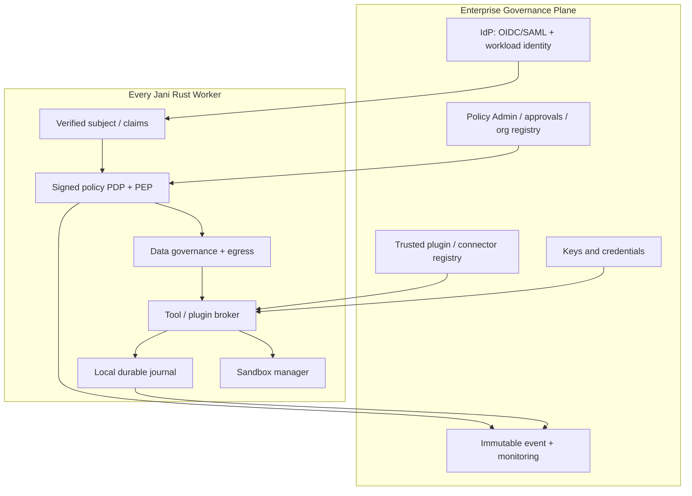
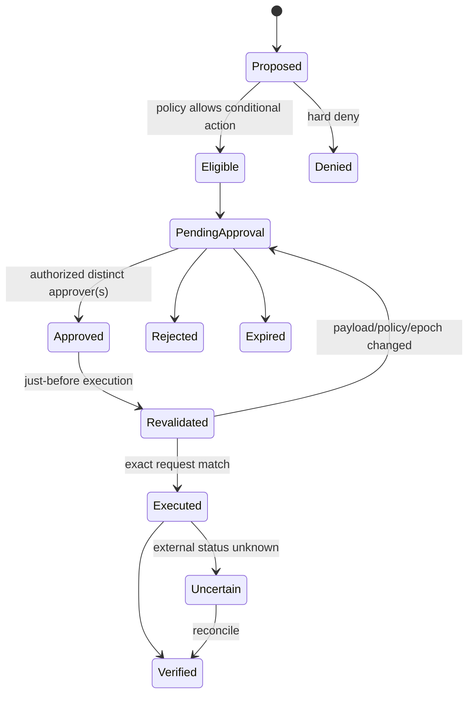

# Jani — Organizational Policy, Identity and Enterprise Governance

**Proposal ID:** JANI-EP-003  
**Revision:** 1.0 · **Status:** Partially implemented — see [IMPLEMENTATION_REVIEW.md](IMPLEMENTATION_REVIEW.md). Signed policy/identity, broker enforcement, approvals, budgets and audit exist; IdP/SCIM, roles/ABAC, policy administration, incidents, checkpoints and offline mode do not.  
**Baseline:** `ifinsta/jani` `main` at `32feebb2fa79dba23e55a6901c23d45d00f0090b`, reviewed 2026-10-25  
**Companions:** [First-Class Sandbox](01_FIRST_CLASS_SANDBOX_PROPOSAL.md) · [Data Governance](02_BUILTIN_DATA_GOVERNANCE_PROPOSAL.md) · [Plugins](04_PLUGIN_ARCHITECTURE_PROPOSAL.md) · [Integrated Rollout](05_INTEGRATED_IMPLEMENTATION_PLAN.md)

## 1. Enterprise decision and scope

Establish an **embedded, mandatory policy-enforcement kernel** and a separable organizational control plane. Jani continues to be a lightweight Rust execution agent: it must work as a standalone CLI and can optionally enroll in a managed organization. Enrollment brings authenticated identities, signed effective policy, versioned configuration, risk-based approvals, budgets, audit, tenant boundaries and external coordination adapters. **The trusted Rust runtime makes final action decisions.** A plugin, LLM, skill file or task coordinator can never grant itself privilege.

**Governance invariants:**

- **GOV-001:** every action is bound to a verified organization/tenant, actor, worker, task purpose, policy revision and effective capability; unregistered local usage is explicitly marked `local-unmanaged`.
- **GOV-002:** deny overrides allow. Effective privilege is the intersection of platform baseline, organization, workspace/project, work-contract and actor grants; approvals can authorize only operations eligible under that intersection.
- **GOV-003:** policy decisions are performed inside a trusted policy enforcement point (PEP), including any call delegated to a plugin, tool, remote worker or coordination engine.
- **GOV-004:** policy and approvals are signed/versioned and audit-linked; a model or repository cannot modify active policy.
- **GOV-005:** high-impact external changes need explicit approval, separation of duties (SoD), idempotency, and post-action reconciliation.
- **GOV-006:** failure, unreachable control plane, stale policy, invalid identity and unknown operation are **deny**, unless a preauthorized signed offline lease explicitly covers low-risk actions and remains valid.
- **GOV-007:** administrators cannot secretly remove audit logging or disable tenant isolation in enterprise mode; changes require elevated controlled workflow with dual control for sensitive categories.
- **GOV-008:** Hivewire task ownership is a coordination signal—not a human identity, RBAC grant or proof of authentication.

## 2. Governance boundary: local agent versus enterprise control plane



**Deployment topology:**

1. **Local unmanaged:** no tenant control plane; safe default read-only behavior, restricted write/exec, trusted-dev warning; explicit local operator is not an enterprise identity.
2. **Organization-enrolled desktop/CLI:** signed policy bundles and device/worker identity; offline low-risk tasks with bounded lease and local journal; high-risk actions require live approval.
3. **Enterprise worker pool:** registered workers; authenticated service control; job leases; protected databases; central policy, logging, approvals, secrets and verified release distribution.
4. **Air-gapped organization:** pinned preapproved policy bundle and local issuer with finite lease; approved local inference and local tool services; prohibit unsupported network or centrally verified operations rather than pretending they succeeded.

## 3. Identity model and tenancy

**Human identities:** authenticate via organization IdP (OIDC preferred for application flows; SAML for compatible IdPs). Assign immutable internal principal IDs rather than rely on mutable email. Support MFA and device posture where risk warrants. SCIM/group synchronization may be an enterprise adapter, not core requirement for local CLI.

**Agent/worker identities:** independently registered workload identities, preferably short-lived mutual TLS credentials and workload attestation where supported. A label such as `jani-worker-3` or a Hivewire alias is not identity proof. Task grants bind `tenant_id + worker_id + actor_id + task_id + audience + nonce + expires_at + policy_hash`.

**Tenancy:** keys, runs, artifacts, worker leases, connector configs and logs are always tenant-scoped. Support organization → department → project/workspace → environment inheritance. No cross-tenant reference without separately authorized sharing workflow and outbound/inbound approvals.

### 3.1 Subject, resource, action and context

```json
{
  "principal": {"id": "human-82", "tenant": "org-example", "groups": ["engineering"]},
  "worker": {"id": "worker-4", "identity_verified": true},
  "task": {"id": "task-332", "purpose": "SOFTWARE_DEV", "budget_id": "budget-19"},
  "action": "repo.write",
  "resource": {"type": "git-worktree", "id": "payments", "path": "src/callback.rs"},
  "context": {"environment": "development", "classification": "CONFIDENTIAL", "time_utc": "2026-10-25T13:00:00Z"},
  "policy_revision": "pol-17"
}
```

All protected attributes must be derived from verified sources by the trusted layer. A model-supplied JSON field is a proposal, not trustworthy actor or environment context.

## 4. Access model: RBAC + ABAC + capability constraints

Use roles for human comprehensibility, attributes for context-specific restrictions, and short-lived capabilities for actual invocation authority.

| Role | Typical rights | Explicit restrictions |
|---|---|---|
| `OrgOwner` | Set organization controls, appoint stewards | Cannot bypass mandatory sandbox, logging, data isolation without extraordinary change workflow |
| `SecurityAdmin` | Security profiles, plugin trust store, incidents | Cannot approve own sensitive operational change |
| `DataSteward` | Data classification/declassification, retention exceptions | Cannot access arbitrary content without need-to-know grant |
| `PolicyAuthor` | Draft and test policy revisions | Cannot alone activate high-impact policy changes |
| `Approver` | Decide requests within delegated risk/domain | Cannot approve own request; cannot override hard deny |
| `Engineer` | Request bounded coding operations in assigned projects | No organization secret exports, unapproved production changes |
| `Auditor` | Review signed policies, redacted evidence and decisions | No write/approve/execute permissions |
| `Worker` | Execute task-bound capability leases | No ability to create new permission grants |
| `Integrator` | Register candidate plugins/connectors for review | Cannot self-sign or promote to trusted production plugin |

Role assignments must be scoped to organization/project/environment. Support explicit “deny” resource policies and risk-based ABAC (time, location when relevant, data class, production flag, recipient, cost, target service). For sensitive access, require justification and expiry.

### 4.1 Effective policy algorithm

```text
Input: verified subject + worker + task + requested action + resource + context
1. Validate signatures, scope, audience, expiry, and tenant correspondence.
2. Load platform baseline and organization/project/workspace policies at pinned revisions.
3. Combine rules; explicit denials and mandatory baseline always win.
4. Intersect granted resources/capabilities with requested task/work-contract scopes.
5. Check data governance, sandbox profile, network, secret, time and budget restrictions.
6. If eligible but approval required, return REQUIRE_APPROVAL with immutable request digest.
7. If approved, ensure approval still binds *same* action/destination/payload hash/epoch.
8. Return short-lived signed per-action capability to tool broker; journal decision ID.
9. Reauthorize if action semantics, principal, policy revision, destination or payload change.
```

Never implement policy by simply asking the model “May I?”. The PEP authorizes the exact operation before any side effect.

## 5. Built-in policy engine design

**Recommended MVP:** a deterministic Rust policy evaluator for the mandatory baseline plus JSON/YAML schema-validated policy rules. Implement a stable `PolicyDecisionPoint` (PDP) trait. Add an **optional OPA/Rego adapter** for advanced enterprise authoring; this must execute as a constrained trusted policy service with signed input and signed/attested responses, never as an uncontrolled plugin callback. Unknown rule syntax, missing policy or PDP timeout must deny.

```rust
pub trait PolicyDecisionPoint: Send + Sync {
    fn evaluate(&self, request: &VerifiedAction) -> Result<Decision, PolicyError>;
}

pub enum Decision {
    Permit { grant: SignedCapability, constraints: EffectiveConstraints },
    RequireApproval { approval_class: String, request_digest: Digest },
    Deny { reason_code: String },
}
```

**Performance:** locally cache verified compiled policy bundles keyed by `tenant + revision + validity + identity + resource` as appropriate; cache **decision logic**, but avoid caching stale successful grants for high-impact calls. Budget, revocation and external state can change. Record decision latencies and cache invalidation; guard against time-of-check/time-of-use with per-action grants and short leases.

## 6. Versioned policy document and policy precedence

```yaml
apiVersion: jani.dev/v1alpha1
kind: OrganizationPolicy
metadata:
  organization: org-example
  id: baseline-v1
spec:
  inheritedFrom: platform-required
  defaults:
    action: deny
    sandboxProfile: enterprise-restricted
    network: deny
    dataEgress: deny
    audit: required
  roles:
    engineer:
      allow:
        - action: repo.read
          resources: [project:payments]
        - action: repo.write
          resources: [project:payments:src/**, project:payments:tests/**]
          environments: [dev, test]
  approvals:
    - when: {action: git.merge, target: protected-branch}
      requiredRole: approver
      separationOfDuties: true
    - when: {action: connector.write, environment: production}
      requiredRole: operations-approver
      separationOfDuties: true
  budgets:
    perTask:
      maxModelSpendUSD: 5.00
      maxToolCalls: 80
      maxWallSeconds: 1800
  plugins:
    registry: organization-approved-only
    unsigned: deny
  policyOutage:
    allowOfflineRead: true
    maxOfflineLeaseSeconds: 900
    allowOfflineExternalMutations: false
```

This schema is proposed, not implemented. Wildcard resource patterns must be parsed into canonical typed resources and evaluated without path confusion, case mismatch or symlink escape. The effective policy after inheritance must be inspectable through `jani policy explain` without exposing secrets.

## 7. Risk engine and approvals

**Risk inputs:** action reversibility, effect scope, production impact, data classification, environment, financial side effects, external recipient, available evidence, plugin trust tier and prior incident history. A risk score is advisory; mandatory hard rules apply regardless of score.

| Risk tier | Examples | Default governance |
|---|---|---|
| `R0` | Read approved public docs | Log, no human approval |
| `R1` | Edit scoped tests in disposable worktree | Auto after policy, sandbox and budget checks |
| `R2` | Apply code patch, connector read on confidential resource | Scoped grant and evidence; selected approval by org |
| `R3` | Deploy staging, publish artifacts, merge protected branch | Approval + independent verifier + transactional gate |
| `R4` | Production deployments, financial transactions, customer exports, policy changes | Separate requester/approver, dual control when required, explicit human confirmation, reconciled receipt |

### 7.1 Approval flow



**Approval request fields:** tenant, requester, worker, task, exact capability/tool, canonical resource/destination, payload digest, target environment, data class, risk, grant boundaries, budget amount, approval policy version, expiration, nonces, required reviewers and justification. Human decisions occur through authenticated UI/CLI. Prevent self-approval, ambiguous approvals, approval replay, race after edit, and approval via a lower-trust plugin.

Approvals do not substitute for tool restrictions. An approver cannot authorize a resource outside organization policy without formally altering policy under its own stronger governance mechanism.

## 8. Budgeting and time authority

Track model cost, call counts, execution time, bytes transferred, external connector spend and optionally vendor-specific quotas. Budgets are **enforced in the broker**, not just passed to the model as text.

- Reserve estimated spend before every provider/tool call; reconcile against actual measured usage. Reject work if no safe reservation remains.
- Support hard and soft limits; a soft limit is a notification, not authorization to exceed a hard limit.
- A task gets a bounded expiry and checkpoint schedule; renewals require policy and potentially human approval.
- Multi-agent coordinator allocations cannot sum to more than parent budget; use atomic ledger reservations to prevent concurrent overspend.
- On budget exhaustion, stop new actions, preserve safe checkpoint and produce an honest partial-completion receipt.

## 9. Audit, evidence and incident handling

Adopt a canonical audit envelope:

```json
{
  "event_version": "1.0",
  "event_id": "evt-1034",
  "tenant_id": "org-example",
  "task_id": "task-332",
  "invocation_id": "inv-554",
  "actor_id": "human-82",
  "worker_id": "worker-4",
  "action": "repo.write",
  "resource_digest": "sha256:<digest>",
  "decision": "permit",
  "policy_revision": "pol-17",
  "approval_id": "approval-34",
  "sandbox_receipt_id": "receipt-12",
  "timestamp": "2026-10-25T13:00:00Z",
  "previous_event_digest": "sha256:<digest>"
}
```

Write audit events to an append-only, integrity-protected event journal with signed export/verification capability and tenant-scoped access. Hash chains reveal tampering but do not by themselves guarantee durability or prevent deletion; use protected storage, rotation, WORM retention where required, independent delivery monitoring and tested backups. The audit stream should not contain raw secrets or sensitive payloads. Use OpenTelemetry spans/metrics linked by IDs with privacy-preserving attributes.

**Incident flows:** detect repeated denied actions, suspicious plugin upgrades, cross-tenant access attempts, sandbox weakening, cost anomalies, policy tampering, unapproved production writes and loss of telemetry. Freeze task/grant, revoke tokens, quarantine plugin, preserve sanitized forensic evidence and notify responsible human. The platform must fail closed if mandatory audit persistence is unavailable for high-risk actions.

## 10. Controlled policy lifecycle

`draft → schema validation → semantic/static analysis → simulation on historical redacted requests → security review → approval → signed publish → canary → activate → monitor → rollback`.

Policy packages have immutable IDs, revision, issuer signature, effective time, expiration, compatible runtime versions and deterministic digest. Runtime verifies signatures against tenant trust roots and persists last-known approved bundle with TTL. A policy author cannot sign/activate their own privileged rule change. Canary policy is shadow-evaluated (without changing the live decision) before activation to detect dangerous drift.

**Emergency operations:** break-glass requires a designated human with MFA, time-limited scoped ticket, second-party review when feasible, explicit reason and real-time alert. **Never** allow break-glass to remove mandatory sandbox, tenant isolation or immutable auditing. For an unavailable organization control plane, use an existing valid signed offline lease only for explicitly eligible low-risk tasks.

## 11. Hivewire integration contract (external coordination retained)

Jani and Hivewire retain separate responsibilities:

- Hivewire owns goal/task assignment, worktree delegation, heartbeats, deputy/escalation, merge sequencing, and coordination receipts.
- Jani owns **verified execution authorization**, tool effects and sandbox receipts.
- Enterprise governance owns organization identity, budgets, security posture, approvals, data rules and compliance evidence.

Hivewire task claims/epochs are presented as signed or otherwise authenticated **coordination assertions**, never security credentials. Jani validates them in addition to its own task lease and denies stale epochs. A task may be “claimed” in Hivewire yet not authorized to read a confidential dataset in Jani. The adapter avoids importing Hivewire's Python runtime into Jani's security boundary and can function over an authenticated subprocess bridge or protocol.

## 12. APIs, CLI and administrator workflows

**Proposed management API (all routes authenticated and tenant-scoped):**

| Route | Purpose |
|---|---|
| `POST /v1/organizations/{org}/policies/validate` | Validate and simulate a policy draft |
| `POST /v1/organizations/{org}/policies/publish` | Dual-controlled signed publication |
| `GET /v1/organizations/{org}/policies/effective` | Inspect redacted effective rules |
| `POST /v1/organizations/{org}/approvals` | Create approval request |
| `POST /v1/organizations/{org}/approvals/{id}/decisions` | Signed approve/reject action |
| `POST /v1/organizations/{org}/workers/enroll` | Enroll verified worker |
| `POST /v1/organizations/{org}/workers/{id}/revoke` | Disable worker/leases |
| `GET /v1/organizations/{org}/audit/events` | Filter redacted audit history |
| `POST /v1/organizations/{org}/plugins/{id}/promote` | Authorize a signed plugin revision |
| `GET /v1/organizations/{org}/budgets/{id}` | Balance/usage/reconciliation |

**Proposed CLI:**

```text
jani enroll --organization <organization>       # trusted enrollment; no model authority
jani identity whoami
jani policy check --action repo.write --resource src/main.rs
jani policy explain --decision <id>
jani approvals list
jani approvals decide <id> --approve             # authorized human only
jani audit verify --run <id>
jani budget show --task <id>
jani workers doctor
```

CLI decisions are not sufficient without actual IdP/session validation and signed policy enforcement in the process.

## 13. Persistence and high-availability model

Minimum durable tables, tenant-scoped: `principals`, `role_bindings`, `worker_identities`, `policies`, `policy_publications`, `action_decisions`, `capability_leases`, `approval_requests`, `approval_decisions`, `task_budgets`, `budget_reservations`, `audit_events`, `incidents`, `trusted_plugins`, `revocations`. Use immutable log entries and separate mutable summary indexes. Core local MVP uses SQLite WAL for one device; organization service may use PostgreSQL with proper migration strategy and HA. No tenant-to-tenant joins without an explicit organizational sharing protocol.

Suggested migration versions: `0001_identity`, `0002_tenant_policy`, `0003_capabilities`, `0004_approvals`, `0005_budget_ledger`, `0006_audit_ledger`, `0007_plugin_trust`. Migration rollout must be reversible for structural changes where feasible, with backups and documented forward-only data handling for irreversible changes.

## 14. Implementation module tree

```text
src/governance/
  identity/{oidc,local,workload}.rs
  tenancy.rs
  principal.rs
  rbac.rs
  abac.rs
  policy/{schema,parser,compiler,signatures,store,pdp}.rs
  capability/{grant,lease,revocation}.rs
  approvals/{workflow,reviewers,receipt}.rs
  budget/{reservation,metering,ledger}.rs
  audit/{event,chain,sink,verification}.rs
  incident/{detector,quarantine}.rs
  controlplane/{api,client,offline_cache}.rs
src/cli/{enroll,policy,approvals,audit}.rs
```

The manager can be a separate Rust crate/service; trusted agent-side verification must remain embedded even when the network is down. Avoid building a remote-only PDP that makes local security dependent on an unreliable round trip.

## 15. Verification catalogue and success gates

| Test | Failure/abuse | Expected |
|---|---|---|
| GOV-001 | Local user forges organization ID | Refused; identity derived from credential |
| GOV-002 | Expired policy bundle | Denied or eligible offline lease only |
| GOV-003 | Model asks for extra permission | No grant |
| GOV-004 | Lower-level project policy allows org-denied action | Denied |
| GOV-005 | Approver approves own R4 action | Denied |
| GOV-006 | Approval payload changed after review | Approval invalidated |
| GOV-007 | Two agents spend same budget balance | Atomic reservations enforce ceiling |
| GOV-008 | Revoked worker retries cached grant | Denied when revocation/lease checks apply |
| GOV-009 | Unavailable PDP on production write | Fail closed |
| GOV-010 | Policy canary broadens sensitive export | Simulation detects impact before publish |
| GOV-011 | Untrusted skill contains `policy: allow-all` | Treated as advisory text only |
| GOV-012 | Plugin self-registers elevated role | Denied |
| GOV-013 | Hivewire claim reused under old epoch | Rejected |
| GOV-014 | Audit sink unavailable for R4 action | Action denied or deferred before side effect |
| GOV-015 | Export audit across tenants | Denied |
| GOV-016 | Approval request nonce replay | Rejected |
| GOV-017 | Emergency override disables sandbox | Always refused |
| GOV-018 | Group synchronization removes user access | Current permissions reflect revocation |
| GOV-019 | Cached policy signed by old key | Key-revocation rules enforce denial |
| GOV-020 | Failure between external mutation and receipt | Mark `uncertain`; reconcile, do not blindly repeat |

**Release gates:** no untrusted authority paths into policy; negative tests pass across tenants and plugin boundaries; deterministic policy evaluation with versioned fixtures; signed policy update/rollback demonstrated; budgets concurrent-safe; approval SoD and exact payload binding proven; high-risk events durably audited; external security assessment before regulated production use.

## 16. Rollout and dependencies

- **GOV-M0:** security architecture ADR, role/tenant model, baseline CLI restrictions and threat inventory.
- **GOV-M1:** signed local policy bundles; strict Rust PDP + PEP around all five built-in tools and model gateway.
- **GOV-M2:** tenant identities, workload registration, offline bounded leases and revocation.
- **GOV-M3:** approval lifecycle, exact payload binding, separation of duties, cost/usage budgets.
- **GOV-M4:** evidence log, incident telemetry, policy simulation and canary release.
- **GOV-M5:** managed IdP/control plane, hardened remote workers, Hivewire adapter, plugin trust registry.

Dependencies on the first-class sandbox, data governance and plugin architecture are explicitly mapped in [Integrated Rollout](05_INTEGRATED_IMPLEMENTATION_PLAN.md). Do not ship advanced RBAC as a replacement for isolation.

## 17. Standards and further reading

- NIST AI RMF: https://airc.nist.gov/airmf-resources/airmf/5-sec-core/
- Open Policy Agent docs: https://www.openpolicyagent.org/docs
- Open Policy Agent policy language: https://www.openpolicyagent.org/docs/policy-language
- OpenTelemetry trace semantics: https://opentelemetry.io/docs/specs/semconv/general/trace/
- OWASP agent security: https://owasp.github.io/DevSecOpsGuideline/2-Process/2-2-Develop/2-2-5-AI-Agent-and-MCP-Security/
- Current Hivewire: https://github.com/ifinsta/hivewire

**Auditability, access control and policy documents do not themselves certify SOC 2, ISO 27001 or any legal regime.**
