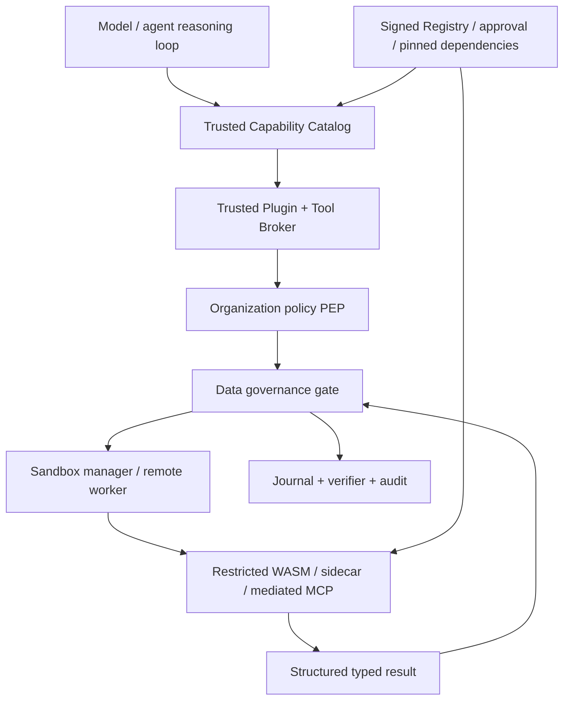

# Jani — Stable Plugin Architecture and Capability Marketplace

**Proposal ID:** JANI-EP-004  
**Revision:** 1.0 · **Status:** Partially implemented — see [IMPLEMENTATION_REVIEW.md](IMPLEMENTATION_REVIEW.md). Signed manifest verification and a capability catalog exist; plugins are not executable, and WASM/sidecar/MCP mediation is missing.  
**Baseline:** `ifinsta/jani` `main` at `32feebb2fa79dba23e55a6901c23d45d00f0090b`, reviewed 2026-10-25  
**Companions:** [Sandbox](01_FIRST_CLASS_SANDBOX_PROPOSAL.md) · [Data](02_BUILTIN_DATA_GOVERNANCE_PROPOSAL.md) · [Organization](03_ORGANIZATIONAL_POLICY_GOVERNANCE_PROPOSAL.md) · [Implementation](05_INTEGRATED_IMPLEMENTATION_PLAN.md)

## 1. Problem and architectural decision

Jani `0.1.0` hardcodes a five-tool dispatcher in `src/agent.rs`, source workspace operations, a single model API client and one command policy in `src/exec.rs`. Adding another provider, business system, capability or execution backend today implies touching Rust internals. Scaling this pattern will turn every integration into a privileged code change, weaken isolation and make releases costly.

**Decision:** introduce a stable, **capability-oriented plugin system** where most capabilities are independently packaged and versioned, without granting plugins control of organizational policy, data-governance enforcement, sandbox enforcement, identity verification or audit. Preserve a small, security-critical Rust core; run ordinary plugins out of process or in a restricted WASM component runtime. Support approved connectors implementing MCP through a mediated adapter; treat `SKILL.md` as human/model guidance, not executable plugins or permission grants.

**Core principle:** **Adding a capability should require a manifest, schemas, tests and a plugin package—not edits to Jani's agent loop.**

### 1.1 Trusted versus extensible boundaries

| Layer | Trusted first-class Rust kernel | Extensible through plugins? |
|---|---|---|
| Verified identity / tenant / signed capability | Yes | Identity provider adapters only |
| Baseline authorization, denial and audit | Yes | Policy *authoring* integrations; no allow override |
| Data classification/egress hard stops | Yes | Detectors, sinks, retention drivers, transformations, constrained by core |
| Sandbox selection/enforcement | Yes | Vetted backend drivers satisfying same conformance contract |
| Durable journal / task state / budgets | Yes | Storage backends with integrity guarantees; not lifecycle authority |
| Model invocation | Trusted gateway | Provider-specific protocol adapters |
| Tool capability discovery and invocation | Trusted broker | Most tools are plugins |
| Retrieval, search, databases, CRM, finance, Git hosting | Policy/egress checked | Yes, least privilege |
| External coordination / Hivewire | Task lease validation | Yes, adapter—not implicit authorization |
| UI, telemetry export, report formatters | Redaction/tenant rules | Yes |

## 2. Architecture: stable ports, replaceable adapters



**All invocation calls flow through the same trusted broker** irrespective of whether the capability originates in a built-in Rust tool, signed enterprise plugin, WASM module, remote MCP server or connector. Plugins cannot register direct privileged model-visible callbacks. Their declared tools are discoverable only **after** signature verification, organization approval and policy filtering.

## 3. Plugin types and runtime choices

| Type | Examples | Execution boundary | Trust requirements |
|---|---|---|---|
| `tool` | Issue tracker, test analyzer, database read, reporting | WASM component or sandboxed sidecar | Signed, scoped data/tool grants |
| `connector` | CRM, email, payments, object store, GitHub, MCP endpoint | Restricted sidecar/remote connector through broker | Approved domain, credentials via broker |
| `model-provider` | OpenAI-compatible, other providers, on-prem inference | Trusted model gateway + adapter | Approved provider policy and egress |
| `classifier` | PII/secret detector, domain taxonomy | Restricted WASM/sidecar | Can increase classification, never independently downgrade |
| `transform` | CSV mapping, anonymization candidate, PDF parse | Sandboxed isolated processing | Output DLP and provenance required |
| `memory` | Retrieval backend, vector index, knowledge store | Broker-managed adapter | Query-time tenant/data policy |
| `telemetry` | OTLP, audit warehouse, dashboard | Sanitized event exports only | No raw secrets/PII by default |
| `coordinator` | Hivewire task lease and status adapter | Authenticated scoped bridge | Cannot create security grants |
| `sandbox-backend` | bwrap, OCI, Windows hardened worker | **Trusted, separately audited and allowlisted driver** | Conformance + signed release; not ordinary untrusted plugin |
| `policy-adapter` | OPA query bridge, administrative policy transport | Trusted PDP/PEP mediates | Deny-on-unavailable; never bypass core invariant |

**Preferred plugin runtimes:**

- **WASM Component Model via Wasmtime** (preferred for deterministic computation, data transforms and pure/tool-limited adapters). Restrict host functions, fuel, epochs/time, memory, file/network access, imports and component API. No blanket WASI filesystem/network exposure. Avoid exposing raw process/host handles.
- **Sidecar process or remote worker** (preferred for complex SDKs, external integrations, large native dependencies or long-lived connectors). Constrain via first-class sandbox and mTLS; service identity, network allowlist, health checks and resource budgets required.
- **MCP adapter** (for ecosystem interoperability): consume MCP tools/resources/prompts via trusted mediation; MCP tool schemas/descriptions are *untrusted declarations*, not authorization. Validate method names, argument/output schemas, and destination identity.
- **Built-in Rust plugins** for high-frequency trusted primitives only; every such inclusion is reviewed as a core release. **Do not dynamically load arbitrary native `.so`, `.dll` or `.dylib` into the privileged process** from third-party publishers.

**Runtime freedom ≠ policy freedom.** A plugin can choose how it implements capability logic within its sandbox; it cannot choose whether it is authorized.

## 4. Plugin artifact and manifest (draft v1alpha1)

```yaml
apiVersion: plugins.jani.dev/v1alpha1
kind: Plugin
metadata:
  id: com.example.issue-tracker
  name: Example Issue Tracker
  version: 1.2.0
  publisher: example-inc
  description: Query and update scoped issues
  license: Apache-2.0
spec:
  engine:
    minVersion: 0.2.0
    apiRange: ">=1.0 <2.0"
  kind: connector
  runtime:
    type: sidecar
    artifact: oci://registry.example.org/jani/issue-plugin@sha256:<digest>
    entrypoint: /app/plugin
    isolationProfile: enterprise-connected
  capabilities:
    - name: issue.list
      version: 1
      effect: read
      riskTier: R1
      inputSchema: schemas/issue-list-input.json
      outputSchema: schemas/issue-list-output.json
      resources: [issue-project:assigned]
      dataClasses: [PUBLIC, INTERNAL, CONFIDENTIAL]
    - name: issue.update
      version: 1
      effect: external_write
      riskTier: R3
      approvalClass: external-write
      idempotency: required
      inputSchema: schemas/issue-update-input.json
      outputSchema: schemas/issue-update-output.json
  requestedPermissions:
    networkServices: [issues-api-approved]
    secrets: [issue-api-token]
    dataPurposes: [SOFTWARE_DEV]
    fsAccess: none
  lifecycle:
    startupTimeoutSeconds: 5
    invocationTimeoutSeconds: 60
    maxMemoryMiB: 256
    maxConcurrency: 4
  provenance:
    sbom: sbom.cdx.json
    signatureRef: artifact-signature
    sourceRepository: https://example.org/issues-plugin
```

**Rules:** manifests are a declaration of requested authority and are insufficient to grant anything. Publish a frozen manifest JSON Schema and supported semantic-version rules. Resolve artifact digests before install and pin exact version/digest for each tenant. Validate package signing identity against trusted publisher policy; verify SBOM/provenance, scan dependencies and obtain approval before activation. Never fetch arbitrary artifact links supplied by a model at runtime.

### 4.1 Tool schema and compatibility

Each capability has: namespaced ID (`publisher.plugin/capability`), stable semantic version, JSON Schema 2020-12 input/output, effect classification (`read`, `local_write`, `external_write`, `irreversible`), idempotency requirements, risk tier, required data classes and purpose, network/secret scopes, result classification, time/memory/CPU limits, and approval class. Avoid ambiguous capability names, version collisions and schema loosening without review.

**Compatibility contract:** additive optional fields may be minor; changes to semantics, destination, effect risk, permissions or mandatory fields are breaking changes even if JSON structure remains compatible. The registry can host multiple plugin versions; each task pins version/digest and must reauthorize before upgrading mid-run.

## 5. Stable Rust interface: broker and plugin transport

```rust
// Design sketch; no equivalent is yet implemented in Jani.
pub trait CapabilityCatalog: Send + Sync {
    fn visible_for(&self, ctx: &VerifiedTaskContext) -> Vec<CapabilityDescriptor>;
}

pub trait PluginTransport: Send + Sync {
    fn handshake(&self, plugin: &ApprovedPlugin) -> Result<NegotiatedProtocol, PluginError>;
    fn invoke(&self, request: AuthorizedInvocation) -> Result<InvocationStream, PluginError>;
    fn cancel(&self, invocation_id: InvocationId) -> Result<(), PluginError>;
    fn health(&self) -> Result<HealthReport, PluginError>;
}

pub struct AuthorizedInvocation {
    pub task_id: TaskId,
    pub invocation_id: InvocationId,
    pub plugin_digest: Digest,
    pub capability: CapabilityId,
    pub validated_arguments: JsonValue,
    pub data_handles: Vec<ScopedDataHandle>,
    pub signed_grant: SignedCapability,
    pub sandbox_profile: SandboxProfile,
    pub idempotency_key: Option<IdempotencyKey>,
    pub deadline: InstantOrUtc,
}
```

The `ToolBroker` performs schema validation, effect classification, canonical resource normalization, `PolicyDecisionPoint::evaluate`, DGK transfer gate, sandbox capability negotiation, credential injection through broker and output scanning. The plugin process sees only filtered grants and approved data handles; it cannot call the policy kernel as an “approve me” endpoint.

### 5.1 Framed sidecar protocol

Specify one versioned transport from Jani to a process/worker (e.g., length-prefixed canonical JSON frames initially, gRPC later). Proposed message kinds:

`handshake`, `capabilities`, `invoke`, `output_chunk`, `complete`, `error`, `cancel`, `heartbeat`, `health`.

```json
{
  "protocol": "jani.plugin/1",
  "type": "invoke",
  "request_id": "req-128",
  "task_id": "task-22",
  "invocation_id": "inv-300",
  "capability": "com.example.issue-tracker/issue.list@1",
  "args": {"project": "alpha", "limit": 10},
  "capability_token_ref": "local-broker://grant-300",
  "deadline_ms": 30000,
  "idempotency_key": null
}
```

Do not serialize raw platform signing secrets or unrestricted provider credentials into transport. `capability_token_ref` is a runtime-local broker handle, not a universally dereferenceable URI. Every response is bounded, schema-validated and passed through output governance. Implement maximum frame size, request rate and streaming backpressure. Propagate cancellation and detect dead peers.

### 5.2 Failure and retry semantics

| Operation class | Retry default | Required protection |
|---|---|---|
| Pure read | Bounded retry with retryable errors | Context/policy recheck, stable read snapshot |
| Idempotent local write | Retry only after checking journal and target generation | Compare-and-swap preconditions |
| Idempotent external write | Retry only with connector-issued status check / same key | Exactly-once *effect* not assumed; reconciliation required |
| Non-idempotent/irreversible | Never blindly retry | Human reapproval/reconcile after `uncertain` |

A plugin crash or version change cannot result in Jani falsely reporting business completion. Plugin failures produce typed errors with stage (`discovery`, `policy`, `sandbox`, `execution`, `validation`, `reconciliation`). Fatal plugin failures can trigger circuit breaking/quarantine and roll back to an *already approved* version only if action compatibility and data/policy constraints remain satisfied.

## 6. Plugin lifecycle and supply-chain governance

`discover → verify signature → scan / attest → register → request scopes → review → approve/pin → install in isolation → handshake → health probe → activate → monitor → suspend/revoke → decommission`.

**Supply-chain requirements:**

- Publisher identity and trust roots; artifact digests; signed SBOM and build provenance; signed metadata; dependency/license inventory; vulnerability gates with documented exceptions.
- No dynamic remote update by plugin itself. The administrative registry pins exact versions/digests and supports staged rollout with rollback.
- Install-time permissions and run-time privileges are independent. A signed plugin is not automatically trusted with customer data.
- New capability, broadened scope, changed model provider, network destination, data retention behavior or tool effect requires re-review and reapproval.
- Capability namespacing avoids collision or hostile shadowing of built-in tools.
- Treat archived/unmaintained plugins as risk signals; block known-compromised digest via emergency denylist.
- Directory and package extraction verify traversal, symlink and bomb limits. Never unpack plugin files into a privileged configuration location.

**Plugin states:** `discovered`, `quarantined`, `verified`, `approved`, `active`, `degraded`, `suspended`, `revoked`, `retired`. States are journaled with actor, reason and release digest.

## 7. SDK and extension developer experience

Publish tiny SDKs, starting with a Rust crate (`jani-plugin-sdk`) and protocol-generated SDKs for Python, Go and JavaScript/TypeScript. SDKs help ergonomics but do not define security. Provide a first-party plugin template (manifest, schemas, reproducible build, tests, mocked broker, container/WASM harness, sample README), `jani plugin init`, `jani plugin test`, `jani plugin package`, `jani plugin sign`, `jani plugin lint` and `jani plugin publish`.

**Example minimal implementation:**

```rust
#[jani_plugin::capability(name = "example.uppercase", effect = "read")]
async fn uppercase(input: UppercaseInput, ctx: RestrictedContext)
    -> PluginResult<UppercaseOutput> {
    Ok(UppercaseOutput { value: input.value.to_uppercase() })
}
```

The macro is *proposed ergonomic syntax*, not shipped API. `RestrictedContext` only exposes controlled logging, cancellation and delegated broker calls; no direct policy mutation or secret access. Target a 30-minute local first plugin creation path after the runtime exists, measured in usability trials rather than assumed.

### 7.1 Development tools

```text
jani plugins list --visible            # effective policy filtered
jani plugins inspect <id> --version <v>
jani plugins doctor <id>
jani plugins install <signed-package>   # requires approval
jani plugins enable <id> --scope <workspace>
jani plugins disable <id>
jani plugins verify <id>
jani plugins test <id> --sandbox required
jani plugins explain <id> --capability <name>
```

`install`, `enable`, `disable` and administrative promotion are controlled actions that cannot be performed merely because a model calls a tool.

## 8. Skills integration: preserve advisory status

Installed `SKILL.md` files remain **instructional resources**; they may tell Jani *how to use* a capability but cannot install/enable plugins, change scopes or bypass approvals. Skills can declare optional dependencies on approved capability IDs with version constraints. The agent loop exposes only the capability catalog filtered for active tenant/task grants. A skill dependency that is unavailable yields a structured prerequisite error, not an implicit installation.

Example optional skill metadata:

```yaml
---
name: issue-triage
description: Read and classify assigned issues
requiresCapabilities:
  - com.example.issue-tracker/issue.list@1
---
```

Use a genuine YAML parser with size/recursion caps for future complex frontmatter; Jani's current minimal line parser is sufficient only for its present simple `name`/`description` use case.

## 9. Built-in model adapter architecture

Replace single `ChatModel` with `ModelGateway` and provider adapter interface. The gateway alone owns provider secrets, model entitlement, prompt construction after DGK authorization, usage accounting, retries and rate limits. Provider adapters implement protocol normalization for chat/tools, structured output, streaming, token usage, error taxonomy and tool-call parsing. A provider is chosen by policy (data class, region, budget, latency/SLO, context requirement) rather than a plugin claiming arbitrary routing privileges.

```rust
pub trait ModelProviderAdapter: Send + Sync {
    fn capabilities(&self) -> ProviderCapabilities;
    fn complete(&self, request: ApprovedModelRequest)
        -> Result<ModelResponse, ProviderError>;
}
```

**Fallback rules:** safe failover requires a fresh data-governance authorization for the new provider, region and model. Never automatically send confidential data to a more permissive endpoint after a rate limit or timeout. Provider rate-limit retries must have reserved budget and bound deadlines.

## 10. Governance hooks and event extensibility

Define immutable typed events: `task.started`, `task.suspended`, `tool.requested`, `tool.denied`, `tool.completed`, `plugin.invoked`, `plugin.quarantined`, `model.requested`, `model.completed`, `data.egress_blocked`, `sandbox.attested`, `approval.requested`, `approval.decided`, `artifact.published`. Event consumers receive **redacted, filtered, tenant-scoped** copies. Notification/webhook plugins cannot veto, forge or mutate trusted event history. Any workflow that needs to block an action must be represented by core policy rules, not an unreliable asynchronous event hook.

Event schemas are versioned; consumer delivery is at-least-once with dedup IDs and dead-letter quarantine. Do not promise exactly-once delivery. Out-of-process plugin events use an outbox pattern for journal integrity and replay after crash.

## 11. Resource budgeting, quotas, performance and resilience

- Maintain per plugin, capability, tenant and task limits for concurrency, CPU/fuel, memory, timeout, byte volume, network calls and connector spend.
- Lazily start plugins and cache healthy workers only when isolation state can be reset and tenant separation is guaranteed. No unsafe cross-tenant pooled process reuse.
- Keep the broker hot path small; measure serialization, policy, sandbox startup and provider latency separately, not just total time.
- Favor self-contained WASM pure capabilities for fast startup; sidecars for heavy SDKs. Measure with reproducible microbenchmarks.
- Apply backpressure to tool result streams and audit dispatch; reject/slow calls when queue limits are reached.
- Define per capability circuit breaker and exponential backoff; do not retry unauthorized or non-idempotent actions blindly.
- Plugin failure is isolated from Jani's privileged runtime; a native crash/undefined behavior in third-party code cannot corrupt the agent memory because ordinary plugins never run in process.

## 12. Test and conformance strategy

| ID | Negative / compatibility case | Expected behavior |
|---|---|---|
| PLG-001 | Unsigned plugin | Cannot activate in managed mode |
| PLG-002 | Signed package with mismatched digest | Quarantined |
| PLG-003 | Plugin manifest requests organization admin grant | Denied |
| PLG-004 | Plugin executes `cargo` via hidden subprocess | Isolated and subject to sandbox policy |
| PLG-005 | Tool returns secret in JSON output | Governed, redacted/quarantined before model sees it |
| PLG-006 | Malicious MCP description claims higher authority | Ignored; trusted catalog overrides |
| PLG-007 | Plugin changes network destination after approval | Fresh policy/egress decision required |
| PLG-008 | Plugin update adds external-write tool | Re-review required |
| PLG-009 | Aborted invocation then external-write retry | Reconcile before repeat |
| PLG-010 | Crash mid-stream or malformed frame | Isolated typed failure, no broker crash |
| PLG-011 | Infinite output / frame bomb | Resource guard terminates plugin |
| PLG-012 | WASM requests unavailable host function | Denied by host capability set |
| PLG-013 | Plugin requests memory or fuel beyond quota | Terminated/quarantined by policy |
| PLG-014 | Dynamic name collision with `workspace_write` | Built-in name protected; plugin namespaced |
| PLG-015 | Tenant B invokes tenant A plugin configuration | Denied |
| PLG-016 | Registry offline during new install | Denied; no unverified install |
| PLG-017 | Cached active plugin later revoked | Invocation blocked/revoked by policy |
| PLG-018 | Sidecar uses inherited API key | No raw credential inheritance |
| PLG-019 | Hook tries to delete audit evidence | No write rights; audit immutable |
| PLG-020 | Provider fallback crosses residency rules | Denied |
| PLG-021 | Plugin dependency conflicts with another major protocol | Distinct isolated instances or reject install |
| PLG-022 | Unknown tool effect | Treated as high risk/denied until classified |
| PLG-023 | Tool schema output lacks mandatory field | Rejected; no data ingress into model |
| PLG-024 | Plugin implements older compatible protocol minor | Negotiation succeeds under published guarantees |
| PLG-025 | Plugin major protocol mismatch | Refused with upgrade diagnostic |
| PLG-026 | Crash while installing package | Atomic activation; previous version remains active |
| PLG-027 | Plugin tries to read host Docker socket | Denied by sandbox |
| PLG-028 | Plugin claims it validated its own sandbox | Insufficient; core attestation required |
| PLG-029 | Plugin publishes raw traces including confidential data | Redaction/egress gate blocks |
| PLG-030 | Skill references unavailable capability | Clear prerequisite error, no auto-install |

**Conformance suites:** developer SDK unit contract tests; protocol golden vectors; schema evolution tests; fuzz parsers/frames/manifests; plugin lifecycle fault injection; independent plugin sandbox escape trials; cost-budget and output-redaction tests; signed/reproducible artifact pipelines; mixed-version rollout. Require green CI on Linux and Windows for platform-supported transports, with declared macOS/remote support boundaries.

## 13. Proposed repository structure and phased refactor

```text
Cargo.toml                         # workspace with existing CLI package
crates/
  jani-core/                       # trusted model-neutral task/tool interfaces
  jani-cli/                        # preserves jani binary & flags
  jani-policy/                     # trusted PDP/PEP
  jani-data/                       # trusted data governance
  jani-sandbox/                    # trusted sandbox manager
  jani-runtime/                    # durable execution/journal
  jani-plugin-api/                 # types, schemas, negotiation
  jani-plugin-host/                # WASM and sidecar supervisors
  jani-provider/                   # approved model gateway
  jani-telemetry/                  # redacted receipts/events
  jani-sdk/                        # separate publishable SDK (no kernel privileges)
plugins/
  builtin-workspace/
  builtin-command/
  github/
  hivewire-adapter/
  model-openai-compatible/
  example-wasm-transform/
schemas/plugins/v1alpha1/
conformance/
  manifests/
  protocol/
  malicious-plugins/
  compatibility/
examples/plugin-template/
```

**Avoid premature crates explosion:** start as Rust modules/interfaces; split into crates only after interfaces/tests stabilize. Preserve current CLI and no-Python-dependency runtime. Use source-compatible wrappers for built-in tools and deprecate the `Agent::tool` switch when the catalog is authoritative. No public SDK stability promise until the contract is exercised by at least two independently built plugins.

### 13.1 Safe incremental migration

1. **PLG-M0:** inventory hard-coded dispatch and provider interface; introduce typed `ToolRequest/ToolResult` and action effect taxonomy; regression fixtures for existing five tools.
2. **PLG-M1:** build `CapabilityCatalog` + `ToolBroker`; wrap built-in tools as trusted adapters; no third-party code yet.
3. **PLG-M2:** add manifest schema, signature/trust validation, registry with pinned versions and lifecycle ledger.
4. **PLG-M3:** add WASM component host for pure transform plugin; strict host function grant; publish SDK/template.
5. **PLG-M4:** add sandboxed sidecar RPC; external read-only plugin; then connected write with approval/idempotency.
6. **PLG-M5:** add mediated MCP adapter and provider adapters; data governance and policy contract tests.
7. **PLG-M6:** Hivewire coordinator adapter; event consumers, protected release/upgrade pipeline, enterprise admin UI/API.

Each step must keep the prior public CLI behavior that remains safe under the new policies. Reversibility is controlled via feature flags only for non-security semantics; mandatory security checks may not be toggled off in enterprise mode.

## 14. First-party plugin catalogue (suggested)

| Plugin | Minimum useful capabilities | Why first |
|---|---|---|
| `jani.git` | status, diff, scoped stage, patch, safe commit | Exercise built-in migration and effect taxonomy |
| `jani.testing` | cargo, pytest, go, dotnet, npm test | Test sandboxed execution and structured evidence |
| `jani.github` | repo read, PR issue read, scoped comment | Read-only then approved external write |
| `jani.hivewire` | task claim/epoch check, inbox, checkpoint, handoff | Integration without embedding coordination engine |
| `jani.files` | workspace and object storage | Data classification and scoped artifacts |
| `jani.sql` | read-only queries with row/column budget | Data governance and typed structured results |
| `jani.web` | approved site fetch through proxy | Egress + injection trust tests |
| `jani.model.openai-compatible` | chat/tool-completion normalization | Current provider migration |
| `jani.dlp` | deterministic secret/PII detectors | Built-in kernel detector expansion |
| `jani.reporting` | generate sanitized reports | End-to-end export and retention tests |

**Prioritize three demo use cases:** safe Rust bug fix in a disposable repo; confidential code review without external data leakage; Hivewire-delegated task with verified, auditable completion. These exercise the common contract better than adding many disconnected integrations.

## 15. Distinctive product advantage

The defensible value proposition is **portable governed capability execution**, rather than a giant toolbox. A single plugin can be built once and used by CLI Jani, a Hivewire workforce, scheduled batch jobs and future enterprise UI, while keeping the same typed grants, sandbox, data limits and evidence semantics. The upgrade path from one local Rust agent to a multi-worker organization therefore becomes **composition**, not a second rewrite.

## 16. References

- MCP tools specification (2026-07-28): https://github.com/modelcontextprotocol/modelcontextprotocol/blob/main/docs/specification/2026-07-28/server/tools.mdx
- MCP specification release: https://blog.modelcontextprotocol.io/posts/2026-07-28/
- Wasmtime Component Model: https://docs.wasmtime.dev/
- Open Policy Agent: https://www.openpolicyagent.org/docs
- OWASP agent/MCP security: https://owasp.github.io/DevSecOpsGuideline/2-Process/2-2-Develop/2-2-5-AI-Agent-and-MCP-Security/
- Jani: https://github.com/ifinsta/jani
- Hivewire: https://github.com/ifinsta/hivewire
