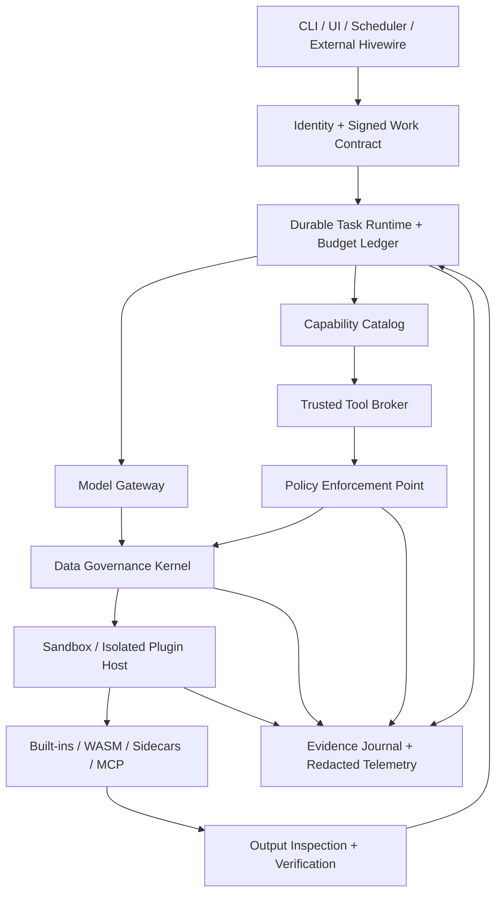

# Jani Enterprise Runtime — Integrated End-to-End Implementation Programme

**Proposal ID:** JANI-EP-005  
**Revision:** 1.0 · **Status:** Partially implemented — see [IMPLEMENTATION_REVIEW.md](IMPLEMENTATION_REVIEW.md). A trusted local vertical slice exists; G0/G1 are partial and G2–G5 are not met.  
**Baseline:** `ifinsta/jani` `main` commit `32feebb2fa79dba23e55a6901c23d45d00f0090b` (2026-10-25)  
**Implement together with:** [01 Sandbox](01_FIRST_CLASS_SANDBOX_PROPOSAL.md) · [02 Data Governance](02_BUILTIN_DATA_GOVERNANCE_PROPOSAL.md) · [03 Organization Policy](03_ORGANIZATIONAL_POLICY_GOVERNANCE_PROPOSAL.md) · [04 Plugins](04_PLUGIN_ARCHITECTURE_PROPOSAL.md)

## 1. Intended result and non-goals

Turn Jani from a small Rust skill-aware coding agent into a **governed, extensible autonomous execution runtime** without embedding an entire multi-agent coordination engine. Hivewire remains external. The central runtime retains mandatory identity verification, policy enforcement, data egress control, sandbox supervision, audit and capability verification. All ordinary tool capabilities, storage backends, model adapters, enterprise connectors and specialized worker behaviors plug into stable interfaces.

**Product requirement:** the same core supports a local developer CLI, one-worktree coding jobs, an external Hivewire worker pool and organization-managed autonomous tasks. Installing a new data or business connector must not require changing `agent.rs`, `exec.rs`, `model.rs` or adding new trusted security exceptions.

**Non-goals:** achieving certifications by code alone; guaranteeing exactly-once external side effects; promising equal OS isolation without measured evidence; replacing Hivewire's team coordination; accepting untrusted plugins as security authorities; forcing Python into Jani's core; building a public plugin marketplace before the local trust and conformance model works.

## 2. Baseline blockers requiring immediate closure

Repository source currently includes one blocking `reqwest` model client, direct `Agent::tool` match dispatch for five tools, `Config`-driven access flags, non-atomic path validation, host `Command` execution without OS sandbox, and no durable conversation/task journal. The preceding review retrieved failed hosted Linux/Windows GitHub Actions runs despite locally passing tests reported in `VALIDATION.md`; root cause was not retrievable. There is also no documented live model-provider coding-session validation. Resolve these before marking a new runtime enterprise-ready.

### Initial acceptance baseline

- `cargo fmt --all -- --check`, `cargo clippy --all-targets -- -D warnings`, `cargo test --all-targets`, `cargo build --release` must pass in hosted CI on supported OSes.
- At least one mock-provider deterministic full agent session including tool call, allowed file edit, denied action and final result.
- At least one live provider (test project, synthetic data and explicit spend cap) produces inspectable events and verified task outcome; redact recordings by default.
- Pin Rust compiler versions and lockfile; produce build provenance and reproducible release checklist.

## 3. Integrated trust-plane architecture



**Architecture rule:** no model-visible or plugin-defined operation may call privileged OS/network/file services except via a trusted, policy-checked broker. The model sees filtered descriptions and receives sanitized results. An identity is never inferred from text in a prompt or repository.

### 3.1 Canonical call pipeline

```text
(1) authenticated user/workload accepts task; immutable work contract created
(2) signed organization policy snapshot fetched/verified; task budget reserved
(3) source reads/data objects classified and source ACL verified
(4) model gateway authorizes provider/region/data transfer; composes minimized context
(5) model proposes typed capability invocation
(6) broker resolves pinned plugin, schema, effect, risk, resource, identity and epoch
(7) PDP enforces restrictions; high-risk action waits for matching approval
(8) data governance checks inputs and outbound destinations
(9) sandbox backend verifies available isolation; starts under approved grant
(10) output streams are bounded, validated, redacted/classified and journaled
(11) trusted verifier checks effects/acceptance, not agent self-assertion
(12) task checkpoint advances; lease and budget are reconciled
(13) final receipt includes results, incomplete work, cost, policy/sandbox evidence
```

**Failure behavior by stage:** missing/invalid identity, policy, classification, backend, verification or mandatory audit → **deny, hold, or quarantine**, never unconfined completion. If an external mutation may have occurred but status is unknown, record `uncertain` and reconcile by idempotency key/provider status.

### 3.2 Event and correlation requirements

Stable, generated (not model-supplied) identifiers: `tenant_id`, `task_id`, `run_id`, `invocation_id`, `decision_id`, `approval_id`, `sandbox_id`, `data_object_id`, `plugin_id@digest`, `policy_revision`, `trace_id`, `attempt_id`, `idempotency_key`. Define one canonical event schema, JSON schema fixtures and compatible versioning. Correlation IDs must survive provider retries and worker restart; sensitive free text is not an ordinary event field.

## 4. Dependency architecture and invariants

| Subsystem | Depends on | Does **not** depend on | Reason |
|---|---|---|---|
| Identity / tenant | Signed issuer config, local verification | Plugins, LLM | Root of actor trust |
| Policy baseline | Identity, typed resource schema, signed rules | Plugin-generated authorization | Mandatory security floor |
| Data governance kernel | Identity, policy, trusted content adapters | Arbitrary ML detector success | Defend source and egress |
| Sandbox manager | Authorized grant, resource profile | Tool-specific business logic | Portable isolation enforcement |
| Plugin catalog | Signed registry, policy filtering | Agent hard-coded tool list | Low-friction extensibility |
| Tool broker | All trusted gates, catalog | Agent prompts | One invocation authority |
| Model gateway | Identity, data egress, budgets | Provider-specific model implementation | Prevent fallback/data leakage |
| Journal and verifier | Durable store, events, tool results | Agent self-attestation | Recoverability and evidence |
| Hivewire adapter | Task/lease protocol and trusted agent registry | Policy engine internals | Keep coordination independent |

No circular dependencies between security and plugin crates. Use injected interfaces for runtime/IO testability, not dependency inversion that allows an untrusted extension to become the PEP.

## 5. Proposed Rust workspace migration

Retain a single `jani` binary for the user and split crates only once the interface contracts and build stability are proven.

```text
jani/
  Cargo.toml                  # eventually [workspace]
  crates/
    jani-types/               # IDs, errors, schemas, policy-neutral envelopes
    jani-core/                # agent state machine, task execution ports
    jani-identity/            # verified principals and signed grants
    jani-policy/              # mandatory baseline PDP and PEP
    jani-data/                # classification, DLP, source/sink gating
    jani-sandbox/             # backend selection, attest, supervisor
    jani-plugin-api/          # versioned capability metadata and protocol
    jani-plugin-host/         # WASM/sidecar/MCP transport
    jani-model/               # provider gateway/adapters
    jani-journal/             # durable run/event store, replay, checkpoints
    jani-audit/               # integrity envelopes and redacted export
    jani-cli/                 # jani executable compatibility
  plugins/
    jani-builtin-tools/
    model-openai-compatible/
    hivewire/
    github/
    wasm-example/
  schemas/
    policy/v1alpha1/
    plugin/v1alpha1/
    data/v1alpha1/
    event/v1/
    work-contract/v1alpha1/
  conformance/
    fake-provider/
    fake-connector/
    hostile-repo/
    hostile-plugin/
    crash-replay/
  docs/architecture/adr/
```

**Practical strategy:** introduce modules inside current `src/` in PRs 1–5; lift them into workspace crates after cross-module interfaces stabilize. Keep old CLI arguments as a compatibility surface but reinterpret them through stricter effective policy. Never silently convert a previously safe `--allow-exec` request into permission to run arbitrary connectors.

## 6. Canonical contract files to define before implementation

The following schemas form the public architecture spine. Their names and versions are proposed; freeze them with deterministic fixtures before publishing SDKs.

| Schema | Minimal required fields | Responsible owner |
|---|---|---|
| `work-contract/v1alpha1` | task ID, actor, tenant, purpose, resources, result checks, deadline, budget, approval class | Task runtime |
| `action-request/v1alpha1` | task, verified actor, capability, resource, typed args, input digests, idempotency | Tool broker |
| `policy-decision/v1` | allow/deny/approval, constraints, revision, decision ID | Trusted PDP |
| `data-envelope/v1` | tenant, source, label/tags, purpose, sink rules, lineage, retention | DGK |
| `sandbox-grant/v1` | profile, mounts, network, process budgets, image digest, signed policy revision | Sandbox manager |
| `plugin-manifest/v1alpha1` | publisher, digest, type, capabilities, schemas, effects, limits, requested scopes | Plugin registry |
| `tool-result/v1` | status, output envelope IDs, side-effect receipt, retry semantics, errors | Tool broker |
| `audit-event/v1` | actor, task, tool, decision, timestamp, digests, chain, retention label | Journal/audit |
| `approval/v1` | canonical request digest, approvers, SoD, expiry, nonce, outcome | Governance |
| `task-checkpoint/v1` | state, cursor, pending tools, effects, leases, budget, evidence | Task runtime |

### 6.1 End-to-end work contract

```yaml
apiVersion: jani.dev/v1alpha1
kind: WorkContract
metadata:
  taskId: task-fix-duplicate-callbacks
  tenant: org-example
  workspace: payment-service
spec:
  purpose: SOFTWARE_DEV
  requesterPrincipal: user-from-authenticated-session
  inputs:
    - source: git
      revision: fixed-commit-id
      paths: [src/payments, tests/payments]
  modelPolicy: enterprise-only
  dataClassification: CONFIDENTIAL
  capabilities:
    - jani.git/read@1
    - jani.git/patch@1
    - jani.testing/cargo-test@1
  sandboxProfile: enterprise-restricted
  output:
    acceptedArtifacts: [patch, test-evidence, risk-report]
  acceptance:
    - callback-idempotency-tests-pass
    - changes-limited-to-authorized-paths
  budget:
    maxUsd: 3.00
    maxToolCalls: 50
    deadlineSeconds: 1200
  approvalPolicy: auto-under-R2
  onFailure: checkpoint-and-report
```

Never treat this file as an executable grant by itself. Trusted runtime substitutes verified identity and resource entitlements, signs a canonical contract digest and validates all referenced resources. A repository-authored work contract can request fewer capabilities or stricter limits, not elevate organizational authority.

## 7. End-to-end critical pathways

### 7.1 Path A: ordinary code fix

`human requests task → scoped work contract → classify repository → approved model gateway → model asks source read → broker policy and DGK → model proposes patch → sandboxed test run → independent verifier → trusted staged patch application → report with source hashes, test exit code and cost`.

Do **not** allow an untrusted `cargo build`/`npm test` script to write outside its temporary layer. Do not equate a successfully written file with a successfully completed user task.

### 7.2 Path B: enterprise external write (issue tracker)

`human task → plugin selection pinned → read allowed issue → model drafts update → policy risk R3 → approval request for destination/issue/payload hash → approval signed → tool broker issues short lease → sandboxed connector sends mutation with idempotency key → connector confirms or marks uncertain → result classified → journal receipt`.

After timeout, reconcile using remote status and idempotency; never “retry until success” if an earlier mutation may have committed.

### 7.3 Path C: confidential data analysis

`data owner approved purpose → connector ingests minimal fields → DGK classify and transform → approved model only if region/protection permit → isolated computation plugin → DLP and aggregation threshold → controlled artifact publish → retention/deletion schedule → audit`.

No plugin can simply export original records to arbitrary model endpoints. Vector indexes, summaries and derived files inherit restrictions.

### 7.4 Path D: Hivewire team execution

`Hivewire assigns task and epoch → authenticated Jani worker validates task claim plus separate enterprise identity/lease → Jani executes governed tools → checkpoints and sends signed evidence references → Hivewire uses ownership/merge gates → Jani/verifier reports actual accepted outcome`.

Hivewire's role is external orchestration; it must not bypass Jani's sandbox, approval or data rules. Integration should remain possible with other coordinators.

## 8. Risk/effort prioritization

| Item | Criticality | Implementation effort | Dependency |
|---|---|---|---|
| Fix hosted CI and reproduce current tool loop | P0 | S | None |
| Typed capability/action/result contracts | P0 | M | CI |
| Central broker and strict baseline PEP | P0 | M | Typed contracts |
| Model egress/data envelope gate | P0 | M–L | PEP + identity |
| Mandatory Linux sandbox and process tree supervisor | P0 | L | Broker + grants |
| Signed plugin registry and isolated WASM host | P1 | L | Broker + sandbox |
| Checkpoint journal and effect/idempotency management | P1 | L | Typed contracts |
| Approval workflow and budget enforcement | P1 | M–L | Identity/policy + journal |
| Sidecar/MCP connector host | P1 | M–L | Plugin registry + sandbox/DGK |
| Windows restricted isolation | P1 for Windows enterprise support | L | Sandbox conformance |
| Tenant-aware multi-worker control plane | P2 until secure local engine | XL | Identity, journal, leases |
| Hivewire adapter | P2 | M | Stable broker + secure task identity |
| Public marketplace/UI | P3 | XL | Trust pipeline, proven SDK |

*Effort sizing is relative (S/M/L/XL), not a delivery date or engineering commitment.*

## 9. Ordered epics and pull-request-sized slices

**Epic E0 — Establish truth and tool safety foundation**

- PR-001: fix Linux/Windows CI; add pinned toolchain and build matrix; capture exact failing step.
- PR-002: fake provider fixture for JSON tool calls, invalid arguments, retryable errors and tool failure; exercise real `Agent::run` against deterministic local endpoint.
- PR-003: define ID types, `ToolRequest`, `ToolResult`, typed errors and action effect classes; snapshot old five-tool behavior.
- PR-004: introduce `ToolBroker`; replace `Agent::tool` match with catalog lookup; migrate all existing built-ins.

**Epic E1 — Central authority and data controls**

- PR-005: signed policy configuration and Rust deny-first PDP; effective scope inspector; negative tests for CLI flag privilege escalation.
- PR-006: data envelope/source classification; initially source-default labels + secret rules.
- PR-007: mandatory provider egress gate and `ModelGateway`; remove direct model dispatch from agent loop.
- PR-008: minimal persistent event journal and correlation IDs; prevent raw sensitive logging.

**Epic E2 — First-class execution isolation**

- PR-009: sandbox capability probe/profile schema; no unconfined execution in managed mode.
- PR-010: Linux restricted bwrap/OCI backend with read-only workspace, explicit write overlay, network deny and sanitized environment.
- PR-011: supervisor, process-tree reaping, quotas, kill on grant expiry; attested receipts.
- PR-012: trusted patch-review/apply path and safe Git integration; hostile crate tests.
- PR-013: supported Windows backend with equivalent acceptance or hardened remote-worker fallback, no misleading `supported` flag.

**Epic E3 — Durable work and enterprise actions**

- PR-014: checkpoint/resume with recovery `uncertain` state and lease expiry.
- PR-015: usage reservations, cost reconciliation, hard budgets.
- PR-016: exact-payload human approval and separation of duties.
- PR-017: credential broker, egress proxy for approved connectors, revocation, reliable audit sink.

**Epic E4 — Stable extensibility**

- PR-018: manifest schema, plugin digest/signature verification, administrative allowlist and lifecycle state.
- PR-019: WASM plugin host, bounded host calls, pure example plugin and conformance test.
- PR-020: sidecar transport, cancellable streaming, idempotency contracts, approval-bound write operation.
- PR-021: MCP adapter, data classification and tool description hardening.
- PR-022: model adapter interface, approved provider routing and fallback tests.
- PR-023: Hivewire bridge and multi-agent lease/epoch validation.

**Epic E5 — Managed enterprise operation**

- PR-024: tenant/organization entity model, IdP enrollment and worker identity.
- PR-025: policy publish/simulation/canary API and audited approval UI/CLI.
- PR-026: encrypted tenant storage, retention/erasure and backup-restore deletion tests.
- PR-027: central monitoring, incident quarantine, signed export and vulnerability response.
- PR-028: signed versioned binaries/plugins, release conformance pipeline, hardening and external security review.

**Implementation principle:** PR IDs are work packages, not prescribed number of GitHub PRs; each may be split. Every PR includes unit tests, negative security tests, migration notes and updated API/schema fixtures. No blanket “we'll test at the end.”

## 10. Cross-feature decision matrix

| Operation | Require actor | Policy PEP | Data gate | Sandbox | Approval if high risk | Durable audit |
|---|---:|---:|---:|---:|---:|---:|
| Model request with public context | Yes | Yes | Yes | Gateway isolation, not arbitrary tool sandbox | Policy-dependent | Yes |
| Model request with confidential context | Yes | Yes | **Mandatory** | Trusted provider boundary | Policy-dependent | Yes |
| Read source file | Yes | Yes | **Mandatory** | File broker/path restrictions | Usually no | Yes |
| Write proposed patch | Yes | Yes | Output classify | Trusted staged apply | Policy-dependent | Yes |
| Execute repo command | Yes | Yes | Inputs/outputs | **Mandatory** | Policy-dependent | Yes |
| Invoke WASM transformation | Yes | Yes | Both directions | **Mandatory host limitation** | Policy-dependent | Yes |
| Call external read plugin | Yes | Yes | Both directions | Broker/sidecar restrictions | Policy-dependent | Yes |
| Call external write plugin | Yes | Yes | Both directions | **Mandatory** | Often yes | Yes |
| Change active org policy | Human/authorized admin | **Mandatory** | Metadata policy | Trusted admin service | Dual control for high risk | **Mandatory** |
| Install / upgrade plugin | Human/authorized admin | **Mandatory** | Manifest governance | Isolated staging | Often yes | **Mandatory** |

No operation bypasses logging merely because it is high throughput or locally invoked. Read-only does not imply data-safe if model egress is involved.

## 11. Recovery and concurrency architecture

Persist state machine:

```text
created → validated → authorized → queued → running → waiting_approval
      ↘ denied                ↘ checkpointed ↔ running
                            ↘ uncertain → reconciling → completed/failed
                                              ↘ quarantined
```

Guarantees are **at-least-once task dispatch**, idempotent/reconcilable side effects, compare-and-swap workspace patch commit, bounded retries and per-action journal receipts—not magical exactly-once transaction semantics across external services. State transitions use transactional journal updates, monotonically increasing task epochs and signed/verified leases.

Add failure injection for `SIGKILL`, process crash between external side effect and receipt, stale policy, duplicate message, queue delay, expired token, network partition and worker restart. A deputy/coordinator cannot take over without a new epoch and valid work grant.

## 12. Operational controls and SLO proposals

The following are **proposed service objectives** for staging evaluation, not achieved metrics:

| Dimension | Proposed gate/measurement |
|---|---|
| Unauthorized action | 0 successful policy bypasses across defined negative suite |
| Sandbox escape | 0 successful escapes across supported backend adversarial tests |
| Tenant cross-access | 0 successful negative-suite leaks |
| Recovery | 100% crash-injection scenarios reach reconciled/failed/uncertain durable state |
| Audit completeness | All privileged actions have verifiable decision, result and integrity-linked event IDs |
| Policy decision latency | Track p50/p95/p99 under representative load; define budgets after benchmark |
| Plugin reliability | Per-plugin invocation success, availability, timeout and reconciliation rates |
| Data egress | Every provider/plugin transfer has a decision record and approved sink |
| Agent quality | Verified task completion, incorrect edits, human interventions, cost per verified result |
| Security incident | Tested revoke/quarantine path and visible owner notification |

Require datasets covering: hundreds of code tasks across Rust, Go, Python and JavaScript; confidential document workflows; hostile repos/dependencies; 1,000+ fault scenarios; plugin version and signer attacks; multi-tenant access; action approval and revoked grants; provider failures and model hallucinations. Test suite definitions must be repeatable and checked into `conformance/`, not anecdotal trial logs.

## 13. Phased release criteria (no calendar dependency)

### Gate G0 — Reliable current agent

- CI green on supported OSes and live-provider synthetic coding session demonstrated.
- Baseline test results and reproducible build recorded.
- No unsupported enterprise claims.

### Gate G1 — Trusted local kernel

- Single broker enforces all five built-in tools.
- Organization baseline policy and data-governed model egress integrated.
- Structured event IDs and clean trust-boundary tests.

### Gate G2 — Safe autonomous code execution

- Linux mandatory sandbox, complete process-tree supervision and constrained patch application.
- Read-only source/model data handling respects classifications.
- Hostile repository suite and crash-recovery tests pass.

### Gate G3 — Governed extensibility

- Signed plugin registry, WASM + sidecar host, tenant-scoped grants, plugin conformance suite.
- Budget/approval rules and exact-action audit operational.
- Plugin upgrade cannot broaden permissions without review.

### Gate G4 — Enterprise pilot

- Verified Windows support *or* supported isolated remote worker for Windows enterprise users.
- IdP, tenant storage, secure secrets, incident recovery, documented residency/retention controls.
- Real customer pilot uses synthetic/minimized data first; external security review and approvals complete.

### Gate G5 — Enterprise supportable release

- Public threat model, policy reference, signed release, operator runbook, SLOs, incident/vulnerability process, rollback and proven restoration; measured adoption and reliable task outcomes.

## 14. Acceptance demo set

1. **Sandbox denial:** task runs `cargo test` against a malicious build script attempting to read host SSH credentials and contact unapproved network endpoint; file and network access denied, journal and incident receipt visible.
2. **Data governance:** confidential file contains embedded test secret; model prompt gate redacts/blocks it; provider fallback to unapproved region blocked; source owner sees decision record.
3. **Organization approvals:** R3 connector write asks for distinct human approval; changes to payload invalidate approval; transaction idempotency prevents blind duplicate.
4. **Plugin onboarding:** install signed pure WASM `example.uppercase`; expose tool to authorized task via catalog without editing agent loop; plugin malicious host syscall is blocked.
5. **Crash recovery:** force-kill worker after external-write request; resume reports `uncertain`, reconciles provider status and avoids duplicate mutation.
6. **Hivewire integration:** coordinator delegates task, Jani validates authenticated worker/lease/epoch, runs sandboxed code change, submits verifiable result, Hivewire merge gate independently accepts or rejects.
7. **Tenant separation:** malicious task from Tenant B attempts read/write/plugin invocation against Tenant A resources; all denied without existence leakage.
8. **Audit and retention:** artifact classified confidential, stored encrypted with TTL, purged including index; audit retains only permitted minimal evidence; backup restore reapplies erasure tombstones.

A developer can reproduce each demonstration using local scripts with mocked enterprise components; no real payment credentials or customer data in tests.

## 15. Documentation and handover requirements

Required project artifacts before production: architecture ADRs (trust boundaries and isolation guarantees); source-compatible migration notes; runtime schema guide; plugin SDK and manifest specification; administrator guide; local developer `quickstart`; data handling map; provider/connector registry policy; security threat model; CI/conformance evidence; Windows/Linux support matrix; incident response playbook; key rotation/secret management guide; observability dashboards; backup/restore and erasure procedure; compatibility and deprecation policy; release signing and SBOM process.

**Add to `docs/` only after design approval.** Proposed repository destinations:

```text
docs/proposals/sandbox_v2.md
docs/proposals/data_governance.md
docs/proposals/organizational_governance.md
docs/proposals/plugins.md
docs/proposals/integrated_roadmap.md
```

These files are prepared separately and **have not been committed to GitHub**.

## 16. Final architecture recommendation

Make **sandboxing, authorization, data governance, identity and audit immutable properties of Jani's trusted runtime**. Make capabilities, model integrations, tool ecosystems, coordination adapters, retrieval, storage transports and report generation **pluggable**. Preserve a small, typed Rust agent loop with a single broker and durable work contracts. Prove the minimum complete vertical slice before publishing a broad plugin marketplace.

This architecture addresses the present Jani limitations without turning its source into a permanently coupled enterprise monolith. It creates a defensible promise: *an organization can add agent capability without reopening the trusted security boundary for every new integration*.
